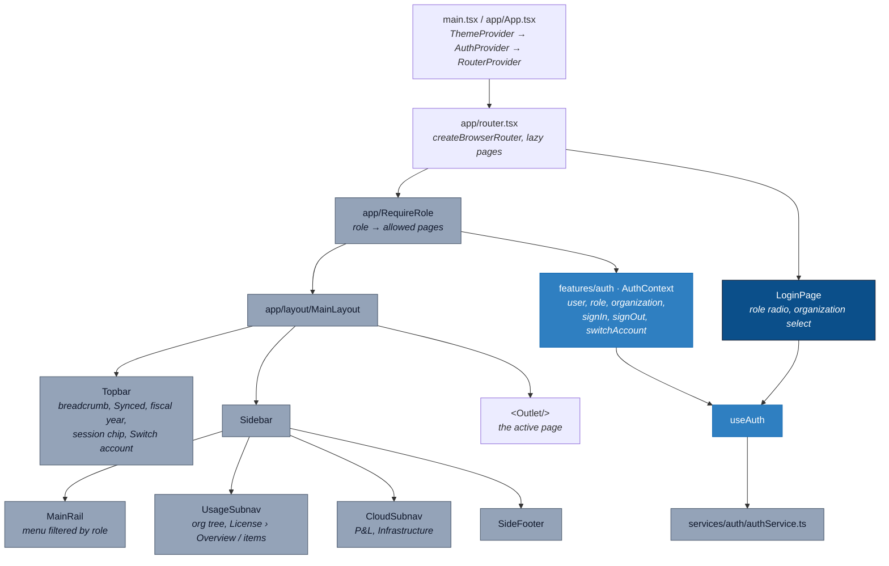
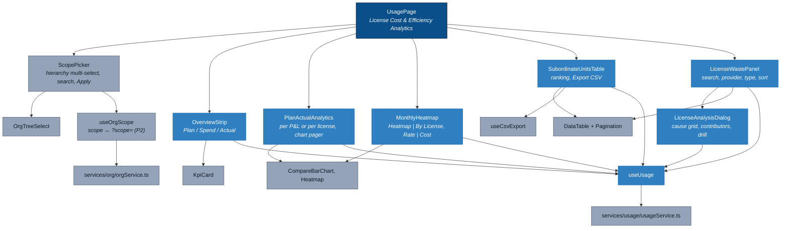
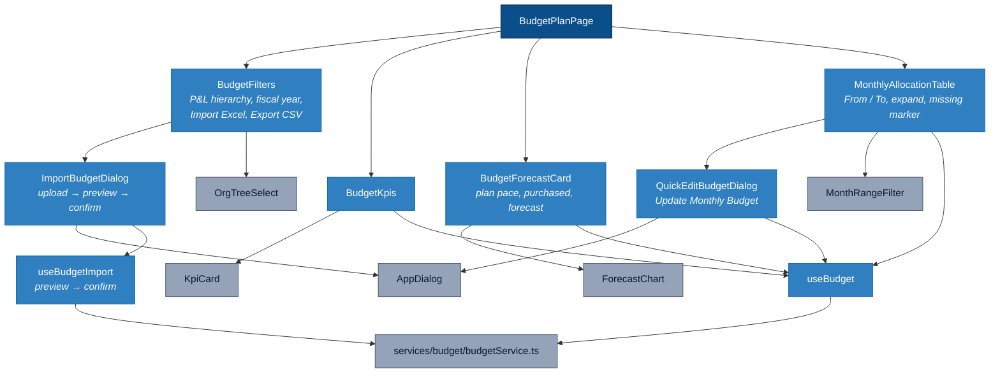
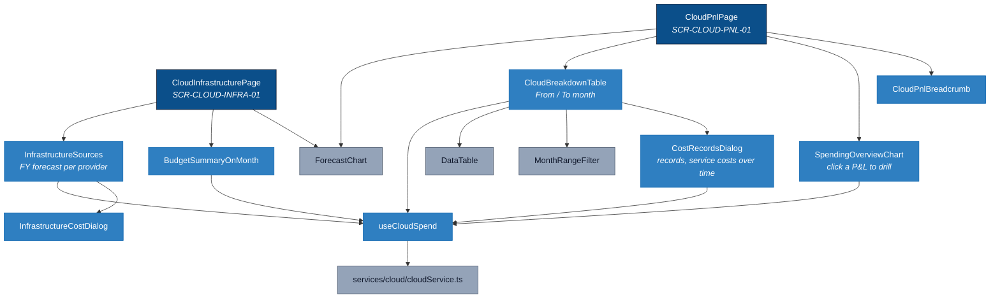
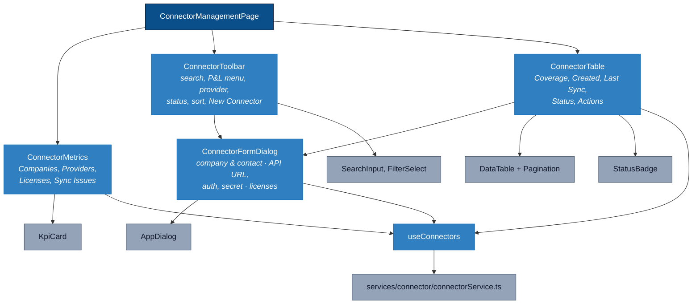

# C4 Level 4 — Code

> **Status:** TARGET · **Audience:** developers
>
> **Baseline:** UI demo [`UI/VFast_UI_v90.html`](../../../UI/VFast_UI_v90.html). Flow, code structure, and responsibilities: [Code structure §3](../../05-code-structure.md#3-frontend).

Level 4 zooms into the **Web Frontend** from [C3 §3](03-component.md#3-web-frontend): each feature folder (`features/<area>`) with its pages, components, and hooks, the service it imports from `services/`, and the `shared/` parts it uses. Every diagram follows the [target flow](../../05-code-structure.md#31-target-frontend-flow) `Page / Component → Feature Hook → Feature Service → apiClient → ASP.NET Core API`; `apiClient` is left out of the diagrams. The backend is left to the source (§2), because a hand-drawn class diagram of it goes stale; its intended classes are in [UML](../uml/README.md).

Colour: dark blue = page, blue = inside the feature folder, grey = `shared/`, `services/`, or `app/`. Arrows never go from one feature to another.

## 1. Web Frontend

### 1.1 Shell, authentication, and routing

### 1.2 Usage (`/usage`, Manager)

**License Overview** (`/usage/licenses`) and **License Detail** (`/usage/licenses/:licenseId`) reuse the same scope and live in `features/licenses`: `LicensePickerFilter`, `LicenseKpiStrip`, `LicenseCostChart` (Plan / Spend / Used), `LicenseSeatChart`, `UnitAllocationChart`, `LicenseDenseList`, and, on the detail page, `AssignedUsersTable`, through `useLicenses` → `services/license/licenseService.ts`. *View assigned users* in the usage dialog navigates to the detail route instead of importing from `licenses`.

### 1.3 Budget Plan (`/budget`, Manager and Staff)

The import is two calls: `POST /budget/imports` returns a preview and a preview key; `POST /budget/imports/{previewKey}/confirm` writes it once (BR-33). See [UML sequence 3](../uml/02-sequence-diagrams.md#3-import-budget-plan).

### 1.4 Cloud Usage (`/cloud/pnl`, `/cloud/infrastructure`, Manager)

### 1.5 Connector Management (`/connectors`)

The secret field is write-only: the form never reads a saved credential back (BR-18).

### 1.6 Other pages

| Feature · page | Components | Hook | Services |
|---|---|---|---|
| `admin` · UserManagementPage (`/admin/users`) | `UsersTable`, `UserEditDialog` | `useUsers` | `userService`, `orgService` |

## 2. Backend and data

| Component | Where to look |
|---|---|
| Backend solution layout | [Code structure §4](../../05-code-structure.md#4-backend): target flow, code structure, responsibilities |
| Intended classes and call order | [UML](../uml/README.md) |
| Entities and fields | [`database/tables.md`](../../database/tables.md), [`database/elms.dbml`](../../database/elms.dbml) |
| Reference DDL | [`database/schema.sql`](../../database/schema.sql) |
| Pure business rules | `Elms.Domain/Rules` (BR-03 seat status, BR-06 allocation, BR-09 and BR-22 Purchased / Used / Wasted, BR-20 waste flag, BR-23 accrual) |

---

[← C3 Component](03-component.md) · [C4 index](README.md)
