# C4 Model — ELMS

> **Status:** TARGET (11 use cases, November 2026) · **Audience:** developers, reviewers, and maintainers

The C4 model describes ELMS at four zoom levels, from the outside in. Every node has a **name**, a **type** (`Person`, `Software System`, `Container`, `Component`), its technology where relevant, and a short description; every arrow says what flows and over which protocol. Diagrams are Mermaid so they render on GitHub.

```mermaid
flowchart LR
    C1["C1 · System Context<br/><small>Who uses ELMS and which systems does it read?</small>"]
    C2["C2 · Container<br/><small>Which processes and stores make up ELMS?</small>"]
    C3["C3 · Component<br/><small>How are Api, Worker, modules, and SPA built?</small>"]
    C4["C4 · Code<br/><small>Which feature folders and components make each screen?</small>"]
    C1 -->|"zoom into ELMS"| C2
    C2 -->|"zoom into Api / Worker / SPA"| C3
    C3 -->|"zoom into Web Frontend"| C4
    style C1 fill:#1168bd,color:#fff,stroke:#0b4884
    style C2 fill:#1168bd,color:#fff,stroke:#0b4884
    style C3 fill:#1168bd,color:#fff,stroke:#0b4884
    style C4 fill:#1168bd,color:#fff,stroke:#0b4884
```

| Level | Document | Scope |
|---|---|---|
| C1 | [System Context](01-system-context.md) | Three roles, P&L license APIs, ILVG, VinSOC, SAP files |
| C2 | [Container](02-container.md) | Reverse proxy, Web Frontend, Elms.Api, Elms.Worker, PostgreSQL, Data Lake |
| C3 | [Component](03-component.md) | Clean Architecture layers, business modules, SPA layers |
| C4 | [Code](04-code.md) | Web Frontend pages decomposed from UI demo v90; pointers for backend code |

The dynamic view (daily pipeline) and the deployment view are in arc42 [§6](../arc42/06-runtime-view.md) and [§7](../arc42/07-deployment-view.md).

## Implementation status

| Unit | Status |
|---|---|
| Web Frontend | `src/frontend/` coded for the previous model; target tree in [Code structure §3](../../05-code-structure.md#3-frontend) |
| UI demo | [`UI/VFast_UI_v90.html`](../../../UI/VFast_UI_v90.html), static HTML with mock data |
| Elms.Api, Elms.Worker | Designed ([Code structure §4](../../05-code-structure.md#4-backend)), not implemented |
| PostgreSQL | Schema designed in [`elms.dbml`](../../database/elms.dbml) and [`schema.sql`](../../database/schema.sql) |

## Colour conventions

- Dark blue: a person, or the unit being zoomed.
- Blue: a container or component inside the boundary.
- Grey: an external system, or a shared element outside the zoom.
- Dashed frame: a system or container boundary.

See also: [arc42](../arc42/README.md) · [UML](../uml/README.md) · [Use cases](../../02-use-cases.md)
