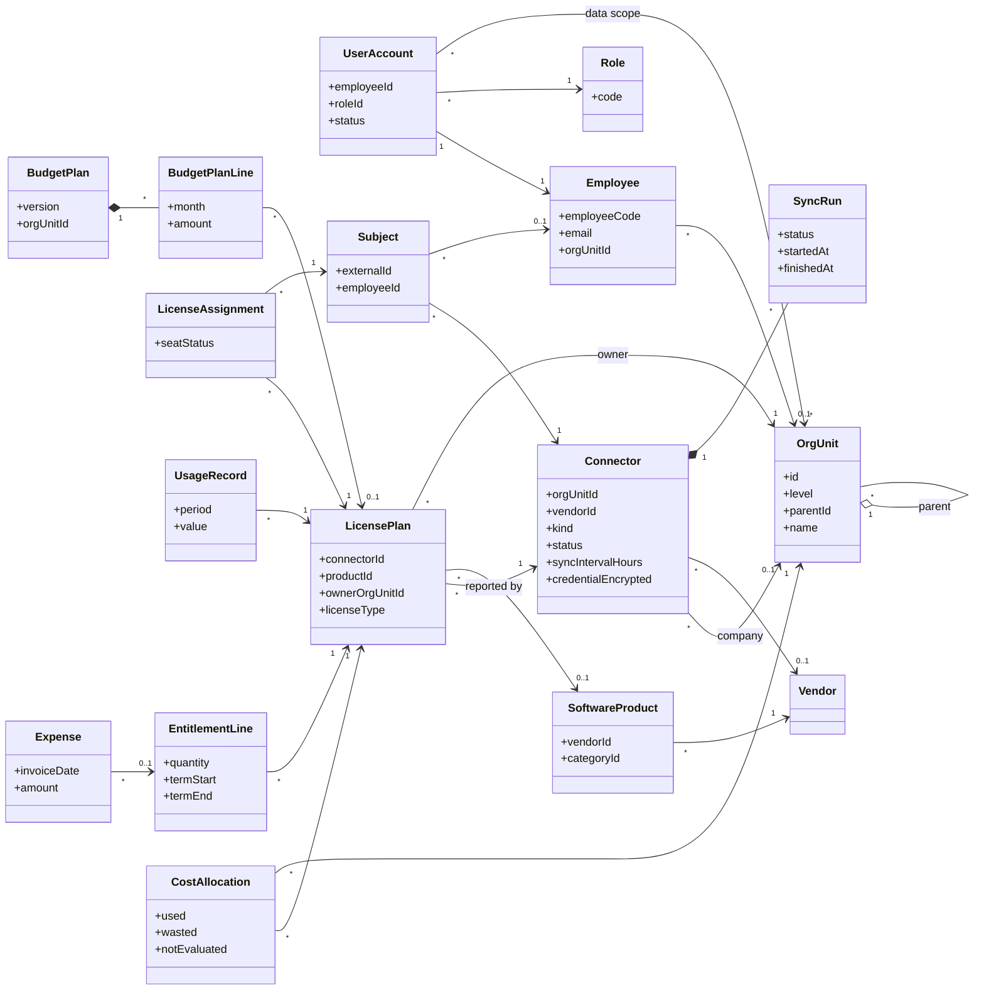

# 1. Class Diagrams

## 1.1 Core domain

The entities the screens of UI demo v90 read, with their main relations. Field lists, retired tables, and constraints are in [`tables.md`](../../database/tables.md) and [`elms.dbml`](../../database/elms.dbml), which stay the source of truth.

## 1.2 Frontend services

```mermaid
classDiagram
    direction TB

    class apiClient {
      <<axios instance · services/apiClient.ts>>
      +get(path, params)
      +post(path, body)
      +put(path, body)
      +delete(path)
    }
    class authService {
      +login(email, password) Session
      +logout()
      +me() Session
    }
    class orgService {
      +tree() OrgUnit[]
    }
    class usageService {
      +balance(scopeId, period) Balance
      +units(scopeId, page) Page~UnitRow~
      +trend(scopeId, year) MonthPoint[]
      +wasteRanking(scopeId, filters) Page~LicenseWaste~
      +unitsCsv(scopeId) Blob
    }
    class licenseService {
      +list(filters, page) Page~LicenseRow~
      +get(id) LicenseDetail
      +holders(id, status, page) Page~Holder~
    }
    class budgetService {
      +plan(unitId, year) BudgetPlan
      +previewImport(file, target, months) ImportPreview
      +confirmImport(previewKey) ImportResult
    }
    class cloudService {
      +byPnl(scopeId, range) CloudRow[]
      +infrastructure(year) CloudSource[]
    }
    class connectorService {
      +list(filters, page) Page~ConnectorRow~
      +test(draft) TestResult
      +create(draft) Connector
      +update(id, draft) Connector
    }
    class userService {
      +list(filters, page) Page~UserRow~
      +updateScope(id, unitIds)
      +setStatus(id, status)
    }

    authService ..> apiClient
    orgService ..> apiClient
    usageService ..> apiClient
    licenseService ..> apiClient
    budgetService ..> apiClient
    cloudService ..> apiClient
    connectorService ..> apiClient
    userService ..> apiClient
```

Only `services/` calls the API. `apiClient.ts` is the one axios instance, built from `config/api.ts` (API prefix, timeout, XSRF names); each module folder (`services/auth/`, `services/usage/` …) has one `<module>Service.ts` that wraps the endpoints of that area. Only feature hooks import a service (`Page / Component → Feature Hook → Feature Service → apiClient`): `import { usageService } from '@/services'`. Every service goes through `http.ts`, which can later wrap the client generated by `openapi-typescript` without components changing.

Every list returns `Page<T> = { items, page, pageSize, total }`; every dashboard response carries `dataDate` and its source (BR-12); missing values are `null` with a reason (BR-04).
