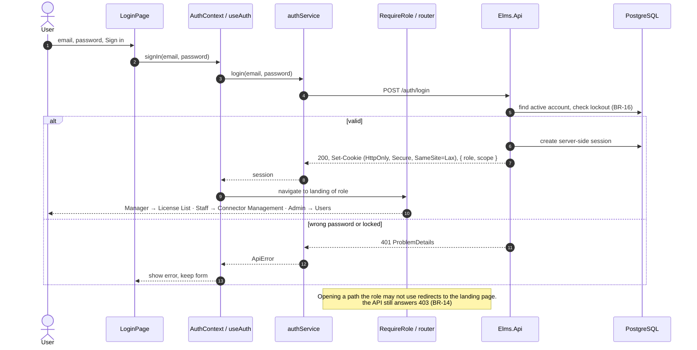
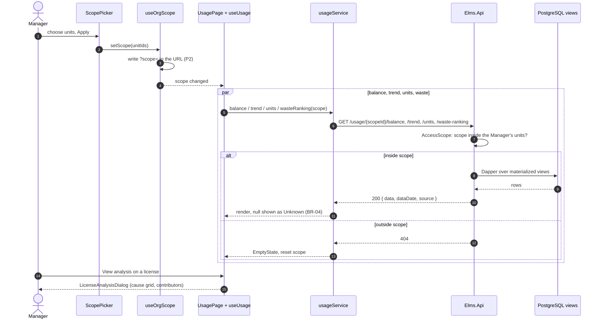
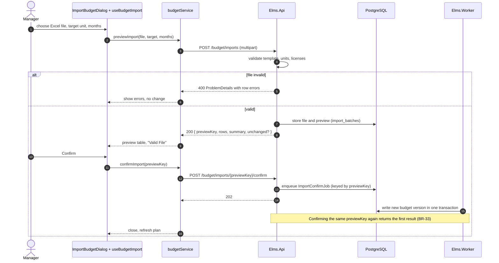
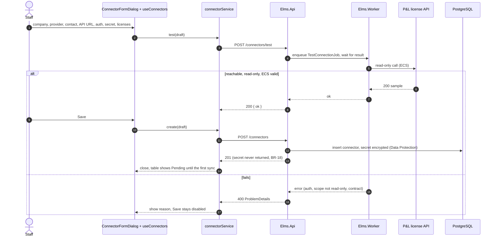

# 2. Sequence Diagrams

Four user scenarios from UI demo v90. Paths are relative to `/api/v1`. Every request passes the three checks of [§8](../arc42/08-crosscutting-concepts.md): authentication (`401`), RBAC (`403`), data scope (`404`).

## 1. Login and role routing

## 2. Usage for a scope

## 3. Import budget plan

## 4. New connector

Open question: the API never calls a source, so the test runs on the Worker; whether the API waits for it (as drawn) or the form polls is to be decided.
