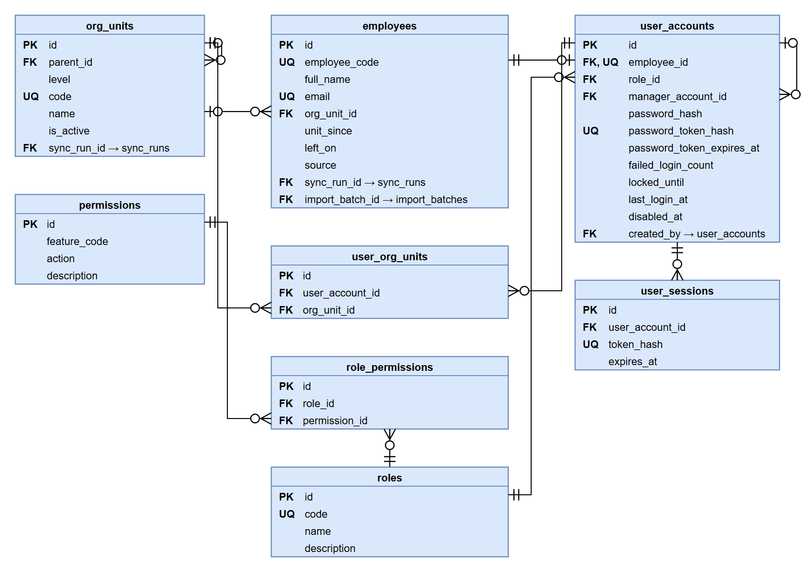
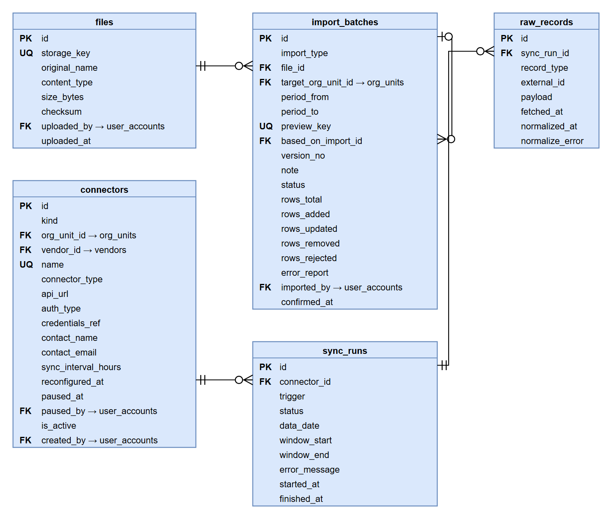
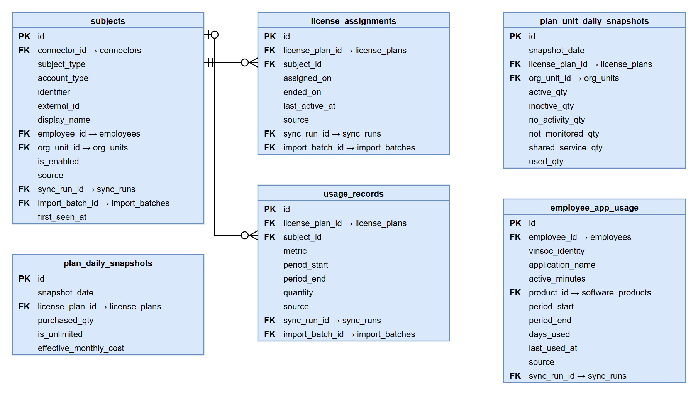

# Database Design

> Design status: TARGET (business model revision, 15 November 2026)
>
> Source: [`elms.dbml`](elms.dbml) (DBML, every rule in the table notes). Reference DDL: [`schema.sql`](schema.sql) (PostgreSQL 15+, generated from the DBML with `@dbml/cli` 12.0.0 plus partial indexes; not yet run against a database). Field by field, in plain words: [`tables.md`](tables.md). Diagrams: [`diagrams/`](diagrams/) — one draw.io ERD per group and the entity overview in Mermaid, each with PNG and SVG.

ELMS keeps, in one PostgreSQL database, what it reads from its sources — licenses, holders, and usage from one usage connector per company and provider, employees and units from ILVG, application usage from BCA — together with the budget plan imported from Excel, the purchases (PO lines and invoices) imported from SAP or typed by Staff, the monthly cost split, and the waste checks. Nothing in it is written back to a source (BR-01). The schema has **40 tables in seven groups**; four of them belong to retired use cases and are kept but not written (D38).

## Conventions

| Topic | Decision |
|---|---|
| Naming | `snake_case`, plural table names |
| Keys | `bigint` identity on every table, so `audit_logs.entity_id` can point to any row |
| License | A license is one row of `license_plans`: one license a connector reports for one company, such as *Microsoft 365 E3* of company A (D1, D26). Its terms are the PO lines in `entitlement_lines`. Holders, usage, budget lines, PO lines, and invoices point to it, so they survive renewals |
| Organization | Five fixed levels in `org_units`: group > P&L > block > department > project (BR-19, D24). Every figure of a unit is the sum of the units under it |
| Unknown | `NULL` means Unknown and is never read as 0 (BR-04). A PO line without a limit is told by its commercial term `pay_as_you_go`, not by a NULL quantity. A total with one Unknown part is Unknown |
| Money | `numeric(18,2)`. Amounts from outside (prices, invoices, budget lines) carry an ISO 4217 `currency`; figures ELMS computes are in the reporting currency (VND) and carry none. Amounts in different currencies are added only through `exchange_rates` (BR-05) |
| Quantities | `numeric(20,4)`: one column serves seats, sessions, tokens, and cores |
| State | No status column beside the field that decides it: the group is the unit without `parent_id`; a connector is paused while `paused_at` is set; a budget line is in force while `superseded_by_import_id` is NULL; a month is closed once `closed_at` is set; a detection result is not evaluated / clear / flagged when `flagged_qty` is NULL / 0 / more than 0. End dates are inclusive |
| Deletion | Master data is never deleted, only ended or marked inactive (BR-13); no cascading deletes |
| Provenance | Every collected row names the `sync_run_id` or `import_batch_id` that wrote it last. Holders and usage come from connectors only: `subjects`, `license_assignments`, and `usage_records` have no `source` and a required `sync_run_id`. A purchase came from the SAP file when `import_batch_id` is set and was typed by Staff when `created_by` is set, exactly one of the two (`chk_*_provenance`, D50) |
| Connector messages | Stored at the level they describe: a failed run in `sync_runs.error_message`; one record in `raw_records.normalize_error`. No secrets in messages |
| History | Providers give no history and a SAP re-import overwrites a PO line, so ELMS freezes results: daily snapshots, and monthly cost allocations when a month closes |
| Rules | Single-row rules are CHECK constraints; partial uniqueness is in `schema.sql`; cross-table rules are "App rule" lines in the DBML notes, enforced by the service in the same transaction |

## Entity overview


Source: [`diagrams/erd_overview.mmd`](diagrams/erd_overview.mmd) (Mermaid, ELK layout). Not drawn: the who-did-it columns (`created_by`, `paused_by` … → `user_accounts`) and provenance (`sync_run_id`, `import_batch_id`).

## Organization and access



- **Five-level tree (D24, BR-19).** `org_units.level` is `group`, `pnl`, `block`, `department`, or `project`; the parent of a unit is one level up, and only the group has no parent. Units and their `code` come from ILVG; the budget file and the SAP purchase file name units by this code. Admin corrects a unit ILVG placed wrongly through `data_overrides` (UC09). When ILVG no longer reports a unit, the sync marks it inactive even if people, budget lines, or licenses remain, and Admin sees it in a list to move them; Admin alone cannot deactivate such a unit (D48).
- **People (D2).** `employees` is the ILVG directory; `org_unit_id` is the unit of the position (department, or block or P&L), never a project, and NULL is "Unknown unit". ILVG gives no transfer date: cost follows the unit of each day's snapshot, so a transfer counts from the day ELMS receives it (BR-25, D44). `project_ids` lists the projects of a person, one or more; a seat they hold counts toward each in equal parts and nothing toward their own unit (BR-06, D39). `user_accounts` has one row per employee and exactly one role (BR-15).
- **Scope (D25, BR-14).** `user_org_units` holds the units of a Manager — any level, the group included — and the companies of a Staff member — P&Ls, or the group for group-level Staff. Admin and Employee have no rows: Admin reads no license data; an Employee reads only their own licenses.
- **Logins (BR-15, BR-16, D22).** Accounts created by the ILVG sync, never by hand; one-time set-password link sent by email, 15-minute lockout after five failures, server-side sessions that end at once when an account is disabled.
- **Settings.** Not in the database: reporting currency (VND), inactivity threshold and new-seat grace (30 days each, BR-03), default sync interval (6 hours, BR-29), month-close day (10), retention of the records read from the data lake (180 days), set-password link validity (72 hours), budget preview validity (60 minutes).

## Software catalog and licenses


- **Licenses come from connectors (D26).** A `license_plans` row is declared by Staff when they create the connector (UC10) and stays *Pending* until the first sync; the sync fills its `external_ref`, holders, and usage. Its license type is the `commercial_term` of its PO line in force. Its quantities and terms come from SAP (D50).
- **Catalog mapping (D28, BR-35).** `product_id` maps the license name to a software of the catalog (UC02), and the software has a category (one level). Mapping one name maps the same name of the same provider in every company. NULL = *Not mapped*, grouped under *Uncategorized*.
- **Owner unit and shared licenses (D27, BR-24).** `owner_org_unit_id` is the P&L of the connector, or the group when the license is used by two or more companies. The owner carries the unassigned seats and plans the license; the held seats are charged back to the holders' units.
- **Terms are PO lines (D50, BR-10, UC01).** `entitlement_lines` are the PO lines imported each month from SAP (`external_ref` = PO number and item, `pr_number`) or typed by Staff for a purchase made outside SAP: company, quantity, term, commercial term, and net price; a `pay_as_you_go` line has no quantity. Purchased quantity is the sum of the lines valid that day; the end of the term is the expiry that drives the License List.
- **Name in SAP (D51).** Budget lines and PO lines find their license by `lower(coalesce(sap_name, external_name))` among the licenses of their P&L and the shared licenses. Staff set `sap_name` when SAP names a license differently from its connector, for example a P&L's own license that has the name of a shared one.

## Collection pipeline



- **Connectors (D26, D34, D37, D40).** A usage connector reads one provider for one company (`org_unit_id`, `vendor_id`; one active per pair), through the HTTPS API the P&L provides for its own data, with an API key or bearer token kept outside the database, a contact, and a `sync_interval_hours` that Staff type freely (default 6). Deleting a connector sets `is_active` false on it and its licenses; the data already collected stays. ILVG and BCA are connectors of their own `kind`.
- **License status (BR-29, D49).** Computed per license from the runs of its connector and `license_plans.last_sync_run_id`, the latest successful run that brought its data: *Paused* while `paused_at` is set; *Pending* while that run is missing or older than `reconfigured_at`, which includes a license added to a running connector; *Failed* when the latest run failed; *Delayed* when that run is older than the interval; *Active* otherwise. Changing company, provider, authentication, or API URL moves `reconfigured_at`, so every license is Pending again.
- **Runs (A3, A4, BR-33).** One `sync_runs` row per run. While a connector is paused, every scheduled slot is still written, with status `paused`, so the pause shows in the run table of UC10. A failed or paused run writes nothing and the day stays Unknown. A rerun of the same day replaces its figures and never duplicates them.
- **Completeness (D8).** A day of a connector is complete when a run for that day succeeded; otherwise it is Unknown and never used to flag waste. Connectors push their data to a data lake, which cleans it; `raw_records` keeps the cleaned records ELMS read, so gaps inside one license are not tracked in ELMS. A record that fails the license data contract is rejected with its reason (BR-17) in `raw_records.normalize_error`; a license the source reports but the connector does not declare is `undeclared_license`.
- **Imports (UC04).** `import_batches` of kind `budget` or `purchase`, preview then confirm; one invalid row rejects the file. A purchase import upserts PO lines and invoices by company and SAP number, so the same file twice adds nothing. See *Budget versions* below for the budget.

## Holders and usage



- **Accounts (D35, D41).** `subjects` belong to the connector (company tenant) that reports them, with a `holder_type` of `person`, `shared`, `service`, `device`, or `api_key`. A shared or service account is judged as a whole: used by anyone in the last 30 days = Active (BR-26). A person is always an ILVG employee, matched by employee code, otherwise by email; a person not in ILVG is rejected (`unknown_employee`). One employee can have several accounts.
- **Seat status (BR-03, D31)** is computed on the data date for an open assignment:

  | Status | Rule |
  |---|---|
  | `Not monitored` | No usage source for the license, or the source gives totals only |
  | `Active` | Used in the last 30 days, or given less than 30 days ago and not used yet (grace period) |
  | `Inactive` | Used before, but not in the last 30 days |
  | `No activity` | Never used, and held for 30 days or more |

- **Usage frequency (BR-32).** Days used = the `active_days` usage records of the holder over the period, shown against working days (Monday to Friday without public holidays) as a bar, for example 6 / 22, without bands; *Not tracked* when the source gives only the last activity date (`license_plans.has_daily_activity`).
- **Snapshots.** `plan_daily_snapshots` keeps Purchased quantity and the list monthly cost per license and day; `plan_unit_daily_snapshots` keeps the seats per status and unit per day as shares (a person on two projects counts half in each), with the shared/service part counted apart. Both are frozen. The unit snapshots of every day of a month are the seat basis of its cost split (D44); the seat counts shown for a month are those of its last day (BR-03).
- **BCA (D36, BR-21).** `employee_app_usage` keeps which application each employee used, on how many days and for how many minutes, in its own table. BCA reports per day the domain account carrying the ILVG employee code. Only the Managers of the employee's units read it (UC03).

## Budget, cost, and expenses


- **Budget versions (D29, D42, BR-08).** Each confirmed budget import is a version of the plan of its target unit (`import_batches.version_no`), for its months. Its `budget_plan_lines` belong to the deepest unit they name, per license and month. An import changes only the licenses in its file: in the target and every unit under it, for those months, a license already planned is overwritten (its lines the file no longer has are removed), a new one is added, and every other license keeps its lines. Replaced lines are marked with the import that replaced them (`superseded_by_import_id`), never deleted. A unit's Plan = its own lines + the Plan of the units under it, so no line is counted twice. The Manager of a P&L can change the plan of the P&L and each block; the Manager of a block only that block. A shared license is planned by the group per P&L that uses it, or deeper, so each P&L's Plan includes its share; P&L Managers can then change or add the lines of their units.
- **Own and shared license with the same name (D51).** The budget file has no *Shared* column: a line maps, by name in SAP, among the licenses of its unit's P&L and the licenses the group owns; a name that matches no license is *Not mapped*, one that matches two is rejected in the preview. A P&L that holds its own *Microsoft 365 E3* and a share of the group's shared one gives its own another `sap_name`.
- **Idempotent and safe import (D30, D43, BR-33).** A file that changes nothing — the same file again, for example — gives `unchanged` and no version. `preview_key` makes the confirm happen once whatever the clicks or retries. `based_on_import_id` is the latest confirmed budget import of any unit at preview; the confirm is refused when an import confirmed after it wrote or replaced a line the file would change, whether it was imported at the same unit, above, or below. Confirms run one at a time.
- **Plan judged where it is set (BR-34).** Cost of a license that has no line at a unit but has one at a unit above — for example a license a P&L plans for all its blocks with one P&L line — shows as *Planned at <unit>* below and is left out of the lower units' variance.
- **Purchased = accrued cost of the invoices (D33, D50).** An invoice (`expenses`) pays a PO line (`entitlement_line_id`) and is spread over its term, or over `service_from`..`service_to` when it names its own period; its `accrual_schedule` spreads the amount over the months, rounded to the thousand VND, with the difference in the last month (BR-23). An amount in another currency is converted with the rate of its invoice date (BR-05). Months are closed per company in `accounting_periods` (UC04); an open month is *Provisional* (BR-28). The fiscal year is the calendar year (D47).
- **Owner change (D46, UC02).** When a license is marked shared, or unmarked, closed months keep the owner they were computed with and open months follow the new owner; a PO line and an invoice keep the company that issued or paid them. A P&L month that carries the cost of a shared license stays *Provisional* until the group's month is closed too.
- **Used, Wasted, Not evaluated (D32, D44, BR-22).** `cost_allocations` splits the accrued cost of each license and month day by day (seat-days): each day carries the cost divided by the days of the month, spread over the larger of purchased and assigned seats, by the seats of that day — the units of the holders, `unallocated` (seats nobody holds, under the owner), and `unknown_unit` (holders that cannot be placed). Over-allocated: 100 seats bought, 110 assigned → the cost spreads over the 110 and nothing is unallocated. A day without complete seat data takes the seats of the nearest complete day of the month (`filled_days`); the cost of a day that cannot be split (Purchased quantity Unknown, or no complete day in the month) is Not evaluated under the owner. A transfer on 15 March gives the old unit 14 days and the new unit 17. Each row carries `used_amount`, `wasted_amount`, and `not_evaluated_amount`, which add up to `amount`. A unit is red when Wasted is above 20 % of Purchased (BR-20). The unit rows of a shared license are its charge-back to the companies.
- **Exchange rates (D12).** Every rate converts to VND; the rate of a day is the latest `effective_from` on or before it.

## Optimization


- **Results (BR-11).** One `detection_results` row per run, license, check, and unit. Checks: `unused` (seats nobody holds, owner unit), `inactive` (Inactive and No activity), `overuse` (allocated above purchased, BR-31), `leaver` (D20). The verdict is read from `flagged_qty`: NULL = not evaluated, 0 = clear, more than 0 = flagged.
- **Shared and service accounts (BR-26)** are judged as whole accounts and listed apart in UC05, never as inactive people.

## Audit


- **Audit log (BR-13).** Append-only: connectors (create, edit, pause, resume), budget imports, catalog mappings, shared-license marks, SAP names, purchase imports and hand entries, users, units, roles, and permissions.
- **Overrides (UC09).** Admin corrections of ILVG data, such as a unit under the wrong parent, keep the original value beside them; licenses, holders, and usage are corrected at the source (BR-01).

## Tables

A plain-language tour of the 33 tables. Every field is explained in [Tables and fields](tables.md); exact rules are in [`elms.dbml`](elms.dbml).

### Organization and access

- **`org_units`**: the group, its P&Ls, blocks, departments, and projects, as ILVG gives them, each with its code.
- **`employees`**: everyone who works in the group, with their current unit, their projects, and the day they left.
- **`user_accounts`**: the people who can log in, each with one role.
- **`user_sessions`**: who is logged in right now.
- **`roles`**: Admin, Manager, Staff, and Employee.
- **`permissions`**: everything that can be allowed, such as "connectors – write".
- **`role_permissions`**: the tick boxes of the permission matrix.
- **`user_org_units`**: the units a Manager looks after and the companies a Staff member works on.

### Software catalog and licenses

- **`vendors`**: the providers, such as Microsoft or Atlassian.
- **`software_categories`**: the categories of the catalog, one level.
- **`software_products`**: the software of the catalog, such as "Microsoft 365", that license names map to.
- **`license_plans`**: each license a connector reports for a company, with its owner unit, its software, and its name in SAP.
- **`entitlement_lines`**: the PO lines of each license, from SAP or typed by Staff: quantity, start, expiry, net price.

### Collection pipeline

- **`connectors`**: the usage connectors of each company and provider, and the ILVG and BCA sources, with their interval, pause, and deletion.
- **`sync_runs`**: the log of each run, paused runs included.
- **`raw_records`**: the cleaned records read from the data lake, kept 180 days, with the reason when a record was rejected.
- **`files`**: invoices typed by Staff, budget files, and SAP purchase files.
- **`import_batches`**: each budget or SAP purchase import, with its target, months, and idempotency key.

### Holders and usage

- **`subjects`**: the accounts at each company's provider tenant — people, shared mailboxes, service accounts, devices, API keys — each pointing to its employee or its owner unit.
- **`license_assignments`**: who holds which license, and when they last used it.
- **`usage_records`**: active days per holder, sessions, consumption, deployed units.
- **`plan_daily_snapshots`**: daily Purchased quantity of each license.
- **`plan_unit_daily_snapshots`**: daily seats per status and unit, as shares.
- **`employee_app_usage`**: which applications each employee uses, from BCA.

### Budget, cost, and expenses

- **`budget_plan_lines`**: the plan per unit, license, and month, with the versions it replaced.
- **`cost_allocations`**: Purchased, Used, Wasted, and Not evaluated of each license and month, per unit.
- **`expenses`**: invoices, the PO line they pay, and their monthly accrual.
- **`accounting_periods`**: the months of each company and whether they are closed.
- **`exchange_rates`**: the rates used to convert currencies to VND.

### Optimization

- **`detection_runs`**: each daily check, with the threshold it used.
- **`detection_results`**: unused, inactive, overused, and leaver seats per license and unit.

### Audit

- **`audit_logs`**: who changed what, when, and why.
- **`data_overrides`**: Admin corrections of ILVG data.

## Rule-to-schema traceability

| Rule | Where it is enforced in the database |
|---|---|
| BR-01 Read-only toward sources | No write-back table; licenses, holders, usage only from `sync_runs` (required `sync_run_id` on holders and usage) |
| BR-03 Seat status | `license_assignments.last_active_at`, `assigned_on`; `license_plans.usage_granularity`, `monitoring_since`; counts in `plan_unit_daily_snapshots` |
| BR-04 Unknown is not 0 | Nullable figures; a connector day without a successful run is Unknown; snapshot counts without defaults; `cost_allocations.not_evaluated_amount`; `detection_results.flagged_qty` NULL |
| BR-06 Cost allocation | `cost_allocations` (bucket, owner unit for `unallocated` and `unknown_unit`, seat-days, `filled_days`); `employees.project_ids`; seat shares in `plan_unit_daily_snapshots` |
| BR-08 Budget | `import_batches.version_no`, `budget_plan_lines.org_unit_id`, `superseded_by_import_id`, `uq_budget_plan_lines_current`; license by `license_plans.sap_name` |
| BR-10 Purchases | `entitlement_lines` (PO lines: `org_unit_id`, `external_ref`, `pr_number`), `expenses.entitlement_line_id`, `chk_*_provenance`, `import_kind` `purchase` |
| BR-13 Audit | `audit_logs` (single-column `id` on every table) |
| BR-14 Data scope | `user_org_units`, `license_plans.owner_org_unit_id`, unit on results |
| BR-15 Roles | `user_accounts.role_id` NOT NULL; `role_permissions` |
| BR-16 Login | `failed_login_count`, `locked_until`, `user_sessions.token_hash` |
| BR-18 Credentials | `connectors.credentials_ref` (secret kept outside), `chk_connectors_https` |
| BR-19 Hierarchy | `org_units.level`, `chk_org_units_group_root`, `uq_org_units_group_root` |
| BR-21 Employee usage | `employee_app_usage` |
| BR-22 Waste | `cost_allocations.used_amount`, `wasted_amount`, `not_evaluated_amount`, `chk_cost_allocations_split` |
| BR-23 Accrual | `expenses.service_from`, `service_to`, `accrual_schedule`; `accounting_periods.closed_at` |
| BR-24 Shared license | `license_plans.owner_org_unit_id` = group; `license_plans.sap_name` |
| BR-26 Account type | `subjects.holder_type`; `plan_unit_daily_snapshots.shared_service_qty` |
| BR-29 Connector status | `connectors.sync_interval_hours`, `reconfigured_at`, `paused_at`; `run_status` `paused`; per license from `license_plans.last_sync_run_id` |
| BR-20 Waste flag | Computed from `cost_allocations`: Wasted above 20 % of Purchased |
| BR-32 Frequency | `usage_metric` `active_days`; `license_plans.has_daily_activity` |
| BR-33 Idempotency | `import_batches.preview_key`, `based_on_import_id`, `import_status` `unchanged`; `uq_entitlement_lines_company_po`, `uq_expenses_company_invoice`, `uq_usage_records_period` |
| BR-35 Catalog | `license_plans.product_id`, `software_products.category_id` |

## Decisions

D1–D23 came from the first design (November 2026). The business model revision keeps D1, D2, D5, D7–D10, D12–D14, D20, and D22, supersedes the others, and adds D24–D41. The schema review of 15 November 2026 adds D42–D49; the decisions of 16 November 2026 add D50 and D51 and supersede D45.

| # | Question | Decision |
|---|---|---|
| D24 | How deep is the organization? | Five fixed levels in `org_units.level`; the group is the only root; units and codes from ILVG |
| D25 | Where is the scope of a Manager and of a Staff member? | `user_org_units` (was `manager_org_units`): Manager units at any level, group included; Staff companies or the group |
| D26 | What is a license now? | A row per license a connector reports for one company; one usage connector per company and provider |
| D27 | Who owns a shared license? | The group; held seats charged back to the holders' companies |
| D28 | How do license names get a category? | `license_plans.product_id` → `software_products.category_id`; NULL = Not mapped |
| D29 | How are budget changes kept? | A confirmed budget import is a version (`import_batches.version_no`); lines superseded, never deleted; a line belongs to its deepest unit |
| D30 | How is a budget import made idempotent? | Preview key, latest version seen at preview (D43), `unchanged` status when the file changes nothing |
| D31 | Seat status and frequency | 30 days, 30-day grace for new seats; days used from `active_days`, no bands |
| D32 | How is waste stored? | Used, Wasted, Not evaluated on each `cost_allocations` row; `unallocated` and `unknown_unit` under the owner |
| D33 | Where does Purchased come from? | Accrued cost of the invoices, rounded to the thousand VND, converted at the invoice-date rate |
| D34 | Sync interval and pause | Interval per connector; `paused_at`; a paused slot is a `sync_runs` row with status `paused` |
| D35 | Identities when each company has its own tenant | `subjects` belong to a connector; `holder_type` person / shared / service / device / api_key |
| D36 | Where is BCA data kept? | Its own table, `employee_app_usage` |
| D37 | How are ILVG and BCA monitored? | As connectors of their own `kind` |
| D38 | What happens to tables of retired use cases? | `contracts`, `entitlement_allocations`, `product_links`, `recommendations` removed |
| D39 | A person on several projects | `employees.project_ids`; a seat counts toward each project in equal parts and nothing toward their own unit; seat counts are shares |
| D40 | Deleting a connector | `is_active` false on the connector and its licenses; data kept; one active connector per company and provider |
| D41 | Shared mailboxes and service accounts | Judged as whole accounts: Active or Inactive like any seat, cost Used or Wasted |
| D42 | What does a budget import replace? | Only the licenses in its file, in the target and every unit under it, for its months: a license already planned is overwritten, a new one added; other licenses keep their lines |
| D43 | Two Managers import at the same time | Preview keeps the latest confirmed budget import of any unit; confirm refused when an import confirmed after it touched a line of its scope (same unit, above, or below); confirms run one at a time |
| D44 | How is a month's cost split over seats? | Seat-days: each day by its own seats, over the larger of purchased and assigned; a day without complete data borrows the nearest complete day (`filled_days`); a day that cannot be split is Not evaluated |
| D45 | Own and shared license with the same name | Superseded by D51 |
| D46 | A license becomes shared, or stops being shared | Closed months keep their owner, open months follow the new one; PO lines and invoices keep the company that issued or paid them; a P&L month with shared cost is Provisional until the group closes |
| D47 | Fiscal year | The calendar year; `accounting_periods.fiscal_year` removed |
| D48 | ILVG stops reporting a unit that still has people or licenses | Marked inactive by the sync and listed to Admin |
| D49 | Connector status of a license | Computed per license from the latest run that brought its data (`license_plans.last_sync_run_id`) |
| D50 | Where do purchased quantity, terms, and invoices come from? | SAP: `entitlement_lines` are the PO lines and `expenses` the invoices, imported each month or typed by Staff for a purchase made outside SAP; connectors no longer give them |
| D51 | Own and shared license with the same name, without a *Shared* column | Match by name in SAP (`license_plans.sap_name`, else the connector's name) among the P&L's licenses and the shared licenses; two matches are rejected; `budget_plan_lines.is_shared` removed |

Superseded: D3 and D19 (quotas), D4 (one yearly budget per unit), D6 (service month), D11 (one tenant per vendor), D15 and D16 (recommendations, contract notice periods), D17 (prices typed by Staff), D18 (manual holders and usage), D21 (HR CSV import), D23 (reseller contracts). Their history is in the git log of this file.

## Seed data

| Table | Rows |
|---|---|
| `roles` | `ADMIN`, `MANAGER`, `STAFF`, `EMPLOYEE` |
| `permissions`, `role_permissions` | The role × feature matrix of [Use cases](../02-use-cases.md) |
| `org_units` | The group row (level `group`); the rest comes from ILVG |
| `employees`, `user_accounts` | One `ADMIN` account from deployment secrets |
| `connectors` | The ILVG and BCA connectors; usage connectors are created by Staff (UC10) |

## Regenerating

```bash
npx -p @dbml/cli dbml2sql docs/database/elms.dbml --postgres   # generated part of schema.sql
cd docs/diagrams && python ve_erd.py                           # diagrams/*.drawio, .png, .svg
```

The generated part of `schema.sql` is followed by the indexes DBML cannot express (partial, case-insensitive, NULLS NOT DISTINCT), listed in the table notes. `ve_erd.py` draws the group ERDs from `elms.dbml` with the team library `srsdiagram.py` (Pillow, Playwright Chromium), renders `erd_overview.mmd` with Mermaid (downloaded from jsDelivr, so it needs network), and deletes the old `.drawio`, `.png`, and `.svg` files first. It stops if a table is missing from `LAYOUT` or the overview names a table that no longer exists.

**Related:** [Use cases](../02-use-cases.md) · [Feature list](../08-feature-list.md) · [Top-down research](../01-research-top-down.md)
