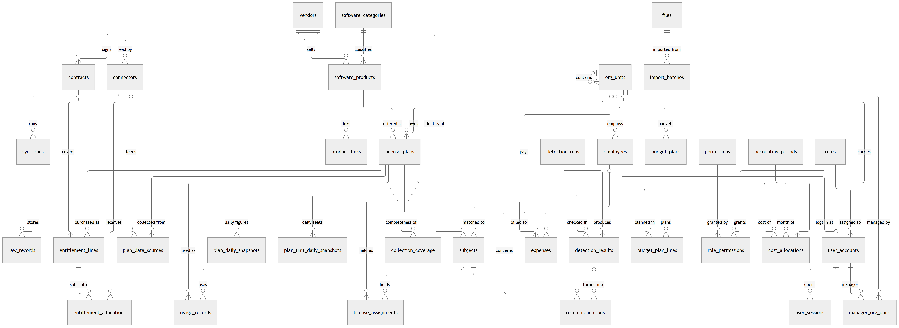
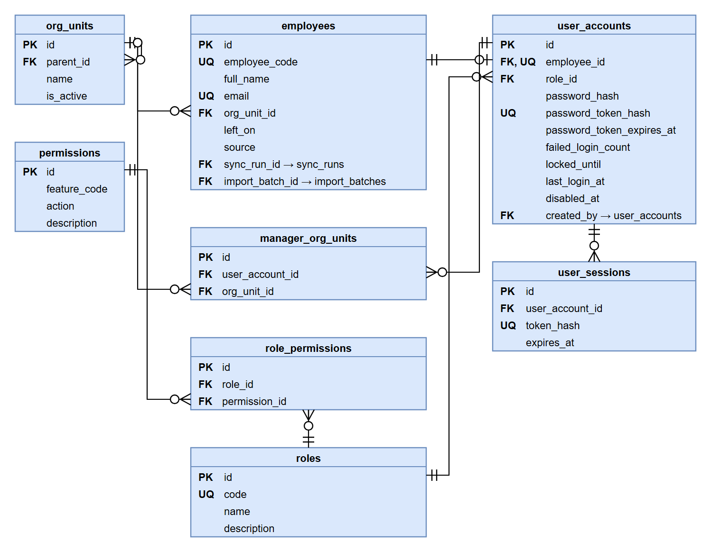
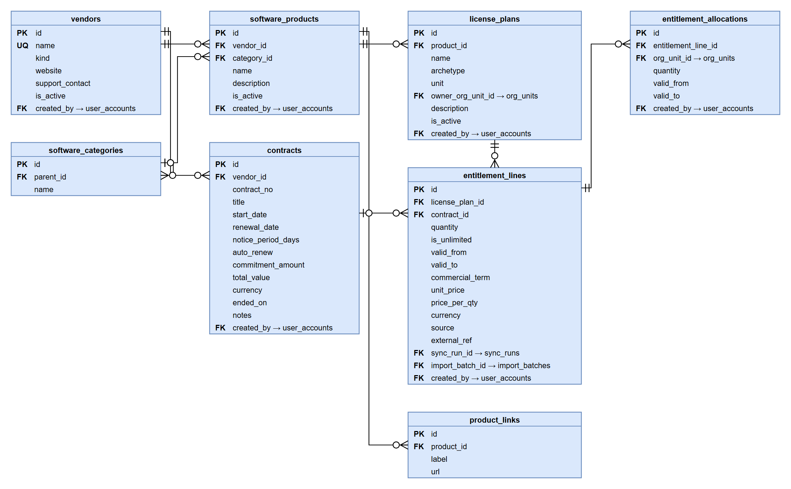
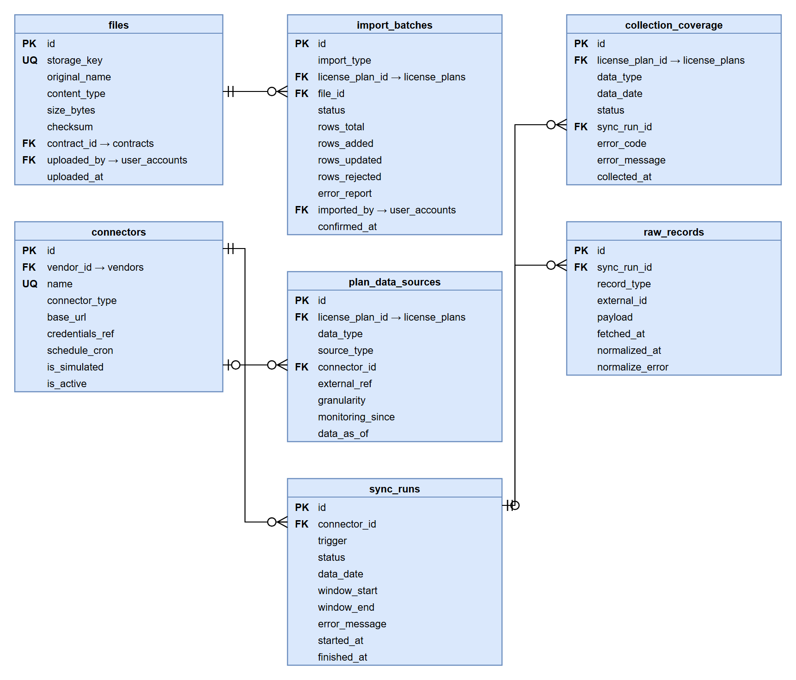
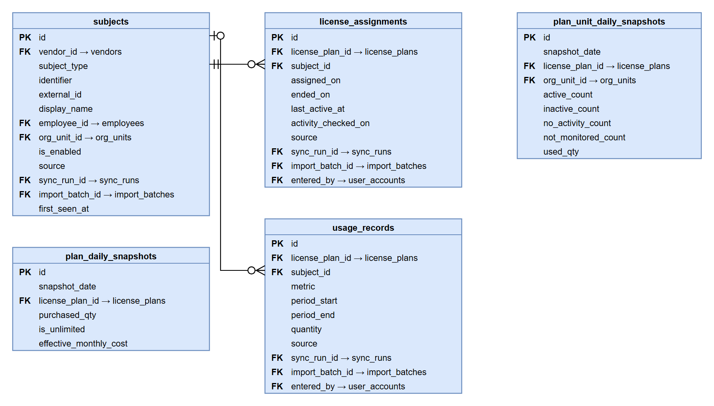
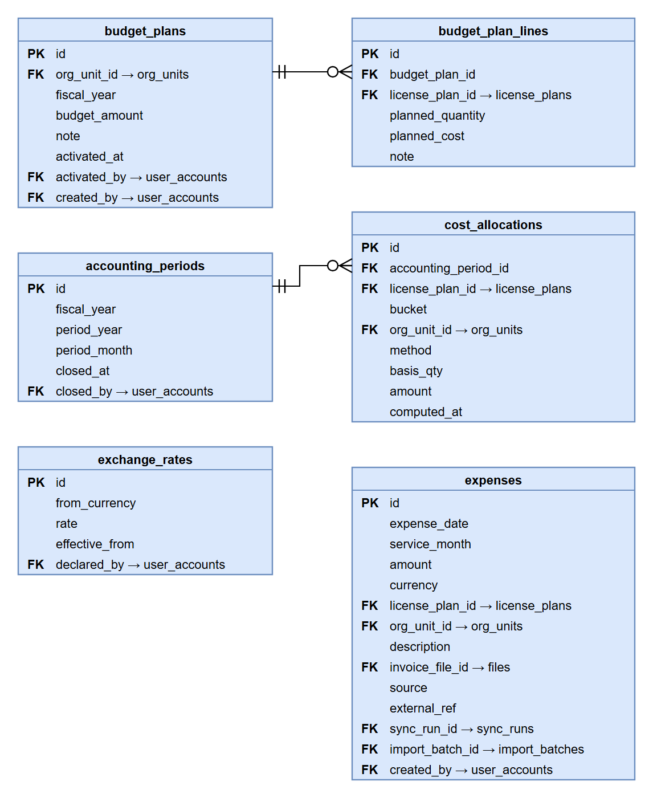
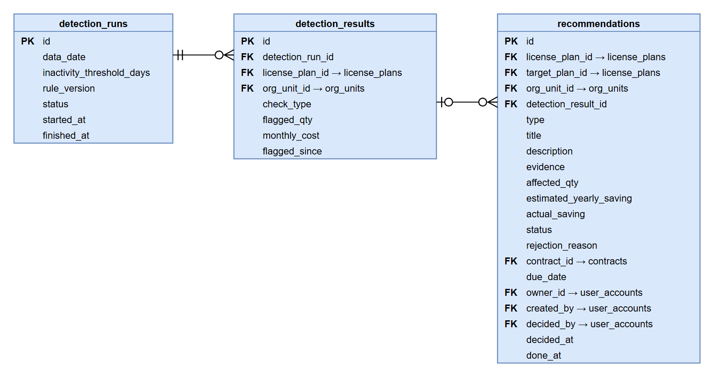
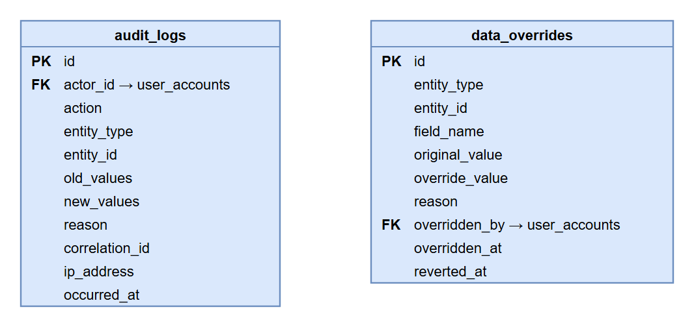

# Database Design

> Design status: TARGET
>
> Source: [`elms.dbml`](elms.dbml) (DBML, every rule in the table notes). Reference DDL: [`schema.sql`](schema.sql) (PostgreSQL 15+, generated from the DBML plus partial indexes; not yet run against a database since the field review). Diagrams: [`diagrams/`](diagrams/) — one draw.io ERD per group, and the entity overview in Mermaid; each with PNG and SVG. Field by field, in plain words: [`tables.md`](tables.md).

ELMS keeps license data collected from providers or entered by Staff, the budget, and the optimization results in one PostgreSQL database. Nothing in it is written back to a provider (BR-01). The schema has 39 tables in seven groups.

## Conventions

| Topic | Decision |
|---|---|
| Naming | `snake_case`, plural table names |
| Keys | `bigint` identity on every table, so `audit_logs.entity_id` can point to any row |
| License | A license is a **plan** (`license_plans`, e.g. Microsoft 365 E3); each purchase is an `entitlement_lines` row. Holders, usage, budgets, expenses, and recommendations point to the plan, so they survive renewals |
| Unknown | `NULL` means Unknown and is never read as 0 (BR-04, A4). "Unlimited" is its own flag. A total with one Unknown part is Unknown |
| Money | `numeric(18,2)`. Amounts typed in from outside (contract values, prices, expenses) carry an ISO 4217 `currency`; figures ELMS computes, budgets, and savings are in the reporting currency (VND) and carry none. Amounts in different currencies are added only through `exchange_rates` (BR-05) |
| Quantities | `numeric(20,4)`: one column serves seats, sessions, tokens, and cores |
| State | No status column beside the field that decides it: an end date (`ended_on`, `valid_to`, `left_on`, `disabled_at`) says whether a row is active; a P&L is a unit without `parent_id`; a budget is active once `activated_at` is set; a month is closed once `closed_at` is set; a detection result is not evaluated / clear / flagged when `flagged_qty` is NULL / 0 / more than 0. End dates are inclusive |
| Deletion | Master data is never deleted, only ended or marked inactive (BR-15); no cascading deletes |
| Provenance | Every collected row has `source` (`api`, `log`, `import`, `manual`) and `sync_run_id` or `import_batch_id` of the run or import that wrote it last, enforced by CHECK. Confidence is derived: per-subject api/log = high; aggregate or import = medium; manual = low (BR-14, A9) |
| Connector messages | Stored at the level they describe: a failed run in `sync_runs.error_message`; one plan, kind, and day in `collection_coverage.error_code` and `error_message`; one provider record in `raw_records.normalize_error`. No secrets in messages |
| History | Providers give no history, so ELMS freezes results: daily snapshots, and monthly cost allocations when a month closes |
| Rules | Single-row rules are CHECK constraints; partial uniqueness is in `schema.sql`; cross-table rules are "App rule" lines in the DBML notes, enforced by the service in the same transaction |
| Diagrams | One ERD per group shows only the relationships inside the group. A foreign key to a table of another group names its target on the column (`org_unit_id → org_units`); who-did-it columns always point to `user_accounts`. `created_at` and `updated_at` exist on most tables and are not shown |

## Entity overview



Source: [`diagrams/erd_overview.mmd`](diagrams/erd_overview.mmd) (Mermaid, ELK layout; edit by hand, the PNG and SVG are rendered from it). Each line is labelled with what the relationship means; crow's foot = many, bar = one, circle = optional.

Not drawn: the who-did-it columns (`created_by`, `decided_by` … → `user_accounts`), provenance (`sync_run_id`, `import_batch_id`), file attachments of contracts and expenses, the contract of a recommendation, and the unit columns of snapshots, results, recommendations, and subjects. `exchange_rates`, `audit_logs`, and `data_overrides` have no relationship other than the who-did-it column.

## Organization and access



- **Two-level tree (UC20).** A row of `org_units` is a P&L (`parent_id` NULL) or a department under one P&L. P&L names are unique case-insensitive.
- **People and logins (D2).** `employees` is the directory; `org_unit_id` NULL is "Unknown department" (BR-06). It is loaded from an HR CSV file or a connector as well as by Admin (D21), so people without an ELMS account still match their provider identities. `user_accounts` has one row per employee and exactly one role (BR-17). Once `left_on` has passed, the account is disabled (D14).
- **First password (D22).** A new account, or "reset password", stores the hash of a one-time link (`password_token_hash`, valid `password_link_valid_hours`). Admin hands the link to the user, who sets the password; no e-mail server is needed.
- **Lockout (BR-18).** Five failures in a row set `locked_until` 15 minutes ahead. Sessions are server-side (`user_sessions`): logout, disabling the account, or a role change deletes them at once (UC19).
- **Permissions (UC22).** `role_permissions` is the role × feature matrix; Employee cannot be granted price or cost features. Every change is written to `audit_logs` with a reason.
- **Manager scope (BR-16).** `manager_org_units` lists the units of a Manager; a P&L covers its departments.
- **Settings.** Not in the database: the reporting currency (VND), the inactivity threshold (60 days), the month-close day (10), raw data retention (180 days), the age limit of manual data (35 days), and the validity of a set-password link (72 hours) are application settings of the API and the worker.

## License catalog and entitlements



- **Publishers and resellers (D23).** `vendors.kind` is `publisher` (owns products and connectors) or `reseller`. A contract is signed with either, so one reseller contract can cover plans of several publishers.
- **One account per vendor (D11).** The group uses one tenant or billing account per vendor, so user ids and subscription ids are unique per vendor. Several tenants per vendor are not modelled.
- **Plan (D1).** `license_plans` fixes the archetype (`allocation`, `concurrent`, `metered`, `capacity`, BR-02) and the counted unit. `owner_org_unit_id` is the unit that buys the license and receives its company-level results (D10).
- **Purchase.** An `entitlement_lines` row has a quantity or `is_unlimited`, validity, `commercial_term`, and `unit_price` for `price_per_qty` units for the period of that term, as the vendor quotes it (2.50 USD per 1,000,000 tokens: `unit_price` 2.50, `price_per_qty` 1000000; D17). Price of one unit p = `unit_price / price_per_qty`. Effective monthly cost (BR-05): monthly = quantity × p; yearly, multi-year, and perpetual maintenance = ÷ 12; prepaid credit = ÷ months of validity; pay-as-you-go = actual spend from `expenses`.
- **Renewal.** A renewal is a new line of the same plan, starting the day after the previous line ends, so the boundary day is not counted twice. A synced subscription is one row per `(license_plan_id, external_ref)` (A3).
- **Purchased.** Sum of the lines active on a day; one line with Unknown quantity makes the sum Unknown.
- **Quotas (D3, D19).** `entitlement_allocations` splits a line with a known quantity among units, each quota with its own `valid_from`/`valid_to`; on every day the active quotas never exceed the line (checked under a row lock). Moving seats between units mid-year ends the current rows and adds new ones; a renewal line copies the quotas in force. A line without quotas is shared.
- **Contracts (UC04).** One FK on the line means a line is under at most one contract. Notice deadline = `renewal_date − notice_period_days`; "Renewal soon" and "Notice period passed" are computed. `notice_period_days` NULL is Unknown, never 0 (D16): the deadline is Unknown and an auto-renewing contract shows "Notice period unknown". A contract can have several files (`files.contract_id`).

## Collection pipeline



- **One primary source (BR-14).** `plan_data_sources` has one row per plan, account, and kind of data (`entitlement`, `assignment`, `usage`, `expense`). A plan whose holders or usage come from a connector refuses manual entry of that data (UC03). A usage source declares `granularity` (`per_subject` or `aggregate`) and `monitoring_since`.
- **Runs (A1, A3, A4).** A `sync_runs` row per connector execution; a failed run writes nothing, so the day stays Unknown, and only a failed run has an `error_message`. What a run returned is found through `sync_run_id`: its payloads in `raw_records` (A2, purged after the retention period), the rows it wrote last in the normalized tables, and its coverage rows.
- **Records ELMS cannot use.** `raw_records.normalize_error` says why a record was not written (`unmapped_sku`, `invalid_date` …). A subscribed SKU linked to no plan is listed for Staff from these records, so no purchase is silently left out.
- **Completeness (D8, D18).** `collection_coverage` says, per plan, account, kind, and day, whether the data is `complete`, `partial`, or `failed`, with the provider's error code and message when it is not. Detection and daily snapshots use only complete days. A successful run that finds 0 holders writes `complete`, so a real 0 is told apart from a missing day; an anonymized usage report is `failed`. Holders and usage entered by Staff are complete while `plan_data_sources.data_as_of` (set by a confirmed import or a "data is current" action) is at most `manual_data_max_age_days` old; a daily job writes their coverage rows.
- **Imports (UC03, UC07, D21).** `import_batches` of kind entitlement, assignment, usage, expense, or employee: preview, then confirm or reject; one invalid row rejects the file. Confirm re-validates the same file.

## Holders and usage



- **Subjects.** Provider identities (user, device, project, API key), matched to `employees` by company email. Department of a subject = the employee's unit, otherwise `subjects.org_unit_id`, otherwise Unknown department. A sync matches on `external_id` first, so a renamed user keeps the seat history.
- **Seat status (BR-03, D7)** is computed for an open assignment:

  | Status | Rule |
  |---|---|
  | `Not monitored` | No usage source for the plan in that account, or the source is `aggregate`, or the source is manual or import and the seat was never checked (no `last_active_at`, no `activity_checked_on`) |
  | `Active` | `last_active_at` within 60 days |
  | `Inactive` | `last_active_at` older than 60 days |
  | `No activity` | `last_active_at` is NULL (for a manual or import source: and `activity_checked_on` is set) |

  UC11 flags a seat only when the usage coverage of the day is complete and both the source and the seat are at least 60 days old. When Staff enter activity for 3 of 10 holders, the other 7 stay `Not monitored` (D18).
- **Usage records.** Peak sessions, consumption, deployed units, or aggregate active users per period. The same period entered again replaces the row (UC03); periods never overlap.
- **Snapshots.** `plan_daily_snapshots` holds Purchased and effective monthly cost per plan and day; `plan_unit_daily_snapshots` holds seats per status and department per day. Both are frozen; the cost of a month is Σ daily rate ÷ days in the month, never the sum of daily rows.

## Budget, cost, and expenses



- **Two cost views (D5).** *Billed* = `expenses`: what the invoice says, on its date (UC07). *Effective* = `cost_allocations`: the BR-05 monthly cost of each plan split by BR-06 into units, `unallocated`, and `unknown_department`. UC06, UC08, and UC16 use the effective view, so the units plus `Unallocated` equal the company total.
- **Allocation methods.** `per_seat` (cost ÷ purchased seats × seats of the unit), `per_usage` (non-seat plans, by department of the subjects), `direct` (pay-as-you-go expenses that name a unit), `none` (all `Unallocated`). Rows of an open month are recomputed daily; closing the month computes them one last time, and a closed month is never recomputed (D9).
- **Budgets (BR-08).** One plan per unit and fiscal year, in the reporting currency; a draft until `activated_at` is set. P&L and department plans are never added: the company total is the P&L plans, and inside a P&L the rest is "Not distributed". A change to an active plan needs a reason and is audited.
- **Expenses (BR-10).** A manual or CSV expense needs a unit (CHECK). A prepaid invoice stays on its date; `service_month` optionally moves a pay-as-you-go bill to the month it pays for (D6). A closed month accepts only correcting entries, dated in an open month (the only negative amounts).
- **Months (D14).** `accounting_periods`: month M closes on day 10 of M+1 by a system job, or earlier by Staff; it is never reopened.
- **Exchange rates (D12).** Every rate converts to the reporting currency. The rate of a day is the latest `effective_from` on or before it. No rate → the converted figure is Unknown and amounts are shown per currency (UC16).

## Optimization



- **Results (BR-12).** One `detection_results` row per run, plan, check (`unused`, `inactive`, `overuse`, `leaver`), and unit. The verdict is read from `flagged_qty`: NULL = not evaluated, 0 = clear, more than 0 = flagged (with a `flagged_since`). Missing or incomplete data is not evaluated, never clear or `Compliant` (UC17).
- **Unit of a result (D10).** Unused: one row per unit with a quota, plus one for the owner unit for shared seats. Overuse: the owner unit. Inactive and leaver: the department of the holders (NULL = Unknown department, shown to the owner unit). A Manager sees only rows of their units (BR-16).
- **Leavers (D20).** Open seats of an employee whose `left_on` has passed, or of a subject with `is_enabled = false` at the provider, are flagged the next day, without the 60-day threshold. Such a seat is not counted again as inactive.
- **Overuse (BR-07, D13).** Allocation: holders > purchased; Concurrent: peak sessions > slots; Capacity: deployed units > licensed; Metered with a quota: consumption over the line's validity > quota. Unlimited lines are never over-used.
- **Recommendations (BR-13).** `proposed` → `accepted` or `rejected` (reason required) → `done` (actual saving required). `contract_id` names the contract whose renewal limits the action; its notice deadline is computed on read, so a corrected renewal date is seen at once (UC13, D16). An Unknown estimated saving is allowed and counted apart (D15). One open recommendation per plan, type, and unit.

## Audit



- **Audit log (BR-15).** Append-only: the application role has INSERT and SELECT only. `correlation_id` links a change to its request or sync run.
- **Overrides (BR-14).** A Staff edit of a connector value (entitlement quantity or validity, billing API expense) needs a reason and keeps the original value; the next sync updates `original_value` and leaves the edited column. One override in force per field.

## Tables

A plain-language tour of the 39 tables: what each one keeps and why ELMS needs it. Every field of every table is explained in [Tables and fields](tables.md); exact rules are in [`elms.dbml`](elms.dbml).

### Organization and access

Who works in the group, how it is organized, and who may log in and see what.

- **`org_units`**: the shape of the group. Each subsidiary (P&L) and the departments inside it, for example the P&L "VinFast Manufacturing" with the departments "IT" and "Finance". Budgets, costs, and what a Manager may see are all counted per unit.
- **`employees`**: the staff list, whether or not the person ever logs in to ELMS. It says which department each person is in, so when Microsoft reports that `an@company.com` holds an E3 seat, ELMS knows the cost of that seat belongs to An's department. When someone leaves, their last working day is recorded here and their seats are flagged.
- **`user_accounts`**: the people who can log in. Each one is an employee with exactly one role. It keeps the hashed password, the 15-minute lock after 5 wrong attempts, and the one-time link a new user opens to set their first password.
- **`user_sessions`**: who is logged in right now. Sessions live on the server, so disabling an account logs the person out at once.
- **`roles`**: the four roles, Admin, Manager, Staff, and Employee. The list is fixed; Admin changes a person's role, not the list.
- **`permissions`**: everything that can be allowed, such as "view contracts" or "edit contracts".
- **`role_permissions`**: which role is allowed what: the tick boxes of the permission matrix that Admin edits.
- **`manager_org_units`**: the units each Manager looks after. A Manager of a P&L also sees its departments, and nothing outside them.

### License catalog and entitlements

What software the group has bought, from whom, how much, and under which contract.

- **`vendors`**: who we buy from: software makers such as Microsoft or Adobe, and resellers, such as a local distributor that sells several brands under one contract.
- **`software_categories`**: folders for the catalog, for example "Office & collaboration" with the subfolder "Email".
- **`software_products`**: a product, such as "Microsoft 365" or "Adobe Acrobat".
- **`product_links`**: handy links of a product: admin portal, terms of service, license policy.
- **`license_plans`**: the thing people actually hold, such as "Microsoft 365 E3" or "OpenAI API pay-as-you-go". This is what the rest of the docs call "a license". It says how the license is measured (per seat, concurrent sessions, tokens, or cores) and which unit owns it.
- **`contracts`**: the signed agreement: start, renewal date, how many days' notice the vendor needs, and value. ELMS uses it to warn before a renewal and to show the last day a cut can still be made. If nobody knows the notice period, it stays empty and ELMS says "unknown" instead of assuming 0 days.
- **`entitlement_lines`**: one purchase, for example "500 E3 seats from 1 Jan to 31 Dec 2026 at 432 USD per seat per year". Buying more or renewing adds a new line under the same license, so the history of quantities and prices is kept. The price is entered as the vendor quotes it, even "2.50 USD per 1 million tokens".
- **`entitlement_allocations`**: an optional split of a purchase between units: "of the 500 seats, 300 are for Sales and 200 for IT". Each split has its own dates, so seats can move between units in the middle of the year.

### Collection pipeline

How data gets in, either from connectors that read provider APIs every night or from Staff typing it or uploading a CSV file, and how ELMS knows whether it has everything.

- **`connectors`**: a configured read-only connection, for example "Microsoft Graph".
- **`plan_data_sources`**: for each license, where each kind of data comes from. For example, E3 holders come from the Graph connector, so Staff cannot type them by hand, while Visio holders come from a CSV file Staff upload. For data entered by Staff it also keeps the day they last confirmed it is up to date.
- **`sync_runs`**: the log of each connector run: when it ran, which day's data it fetched, and whether it worked. If the whole run failed (wrong credentials, provider down), the reason is here.
- **`collection_coverage`**: for each license, kind of data, and day, the answer to "did we get everything?". It stops the classic mistake of reading a failed sync as "nobody used it". When the data is not complete, the provider's error is kept here, for example "permission denied on usage reports".
- **`raw_records`**: exactly what the provider sent, before ELMS reshapes it, kept for 180 days so figures can be recomputed when a rule changes. When a record cannot be used, the reason is noted; for example, a Microsoft SKU not yet linked to any license in ELMS shows up in a "SKUs not in the catalog" list for Staff.
- **`files`**: uploaded files: contract scans and amendments, invoices, and CSV files.
- **`import_batches`**: each CSV upload: who, when, which file, and how many rows were added, updated, or rejected. Nothing is written until Staff check the preview and confirm.

### Holders and usage

Who holds each license, and whether they actually use it.

- **`subjects`**: an identity at the provider: a user account, a device, a project, or an API key. It is linked to an employee when the email matches; an identity that matches nobody still shows, with "Unknown department". It also notes when the provider has disabled the account.
- **`license_assignments`**: who holds what, for example "An has held an E3 seat since 3 March and was last active 2 days ago". Ended assignments stay for history. From the last activity ELMS tells whether a seat is Active, Inactive (unused for 60 days), No activity, or Not monitored (nobody can tell).
- **`usage_records`**: usage that is not one person per seat: peak concurrent sessions of a CAD license, tokens consumed through an API, cores deployed on servers. One figure per period, such as per day or per month.
- **`plan_daily_snapshots`**: a daily photo of each license: how many were purchased and what it costs per month. Providers keep no history, so without these photos there would be no trends and no cost for past months.
- **`plan_unit_daily_snapshots`**: the same daily photo per department: how many seats are held, and how many are active, inactive, and so on. It keeps the department of that day, so a person moving to another team does not rewrite last month's figures.

### Budget, cost, and expenses

How much each unit plans to spend, what its licenses really cost, and the invoices.

- **`budget_plans`**: a unit's license budget for one year, for example "IT, 2027: 2 billion VND". It stays a draft until the Manager activates it.
- **`budget_plan_lines`**: what the budget is for, line by line: "40 E3 seats, 450 million VND".
- **`cost_allocations`**: who carries the cost, month by month. ELMS spreads the monthly cost of each license over the departments whose people hold it; seats nobody holds go to "Unallocated", and holders without a department go to "Unknown department". The figures are frozen when the month closes.
- **`expenses`**: invoices and charges as billed. They are compared with the allocated cost, and they are the real cost of pay-as-you-go licenses.
- **`accounting_periods`**: the months, and whether each one is closed. A closed month can no longer be edited; a mistake is fixed with a correcting entry in an open month.
- **`exchange_rates`**: the rates used to convert USD and other currencies to VND, each valid from a given date.

### Optimization

Where money is wasted, and what to do about it.

- **`detection_runs`**: each daily check, with the threshold and rule version it used, so an old result can still be explained after the rules change.
- **`detection_results`**: what the checks found, per license and unit: seats nobody holds, seats unused for 60 days, seats of people who have left, and use above what was bought. When data is missing the answer is "Not evaluated", never a false "all fine".
- **`recommendations`**: proposed actions, for example "cut 20 E3 seats, saving about 8,600 USD a year", with the evidence, an owner, the contract that limits when it can be done, and the decision: accepted, rejected with a reason, or done with the saving actually achieved.

### Audit

- **`audit_logs`**: who changed what, when, the old and new value, and why. Rows can only be added, never edited or deleted.
- **`data_overrides`**: corrections Staff make to a figure that came from a connector, for example when the API reports the wrong seat count. The original value stays beside the correction, and the next sync does not overwrite it.

## Rule-to-schema traceability

| Rule | Where it is enforced in the database |
|---|---|
| BR-03 Seat status | `plan_data_sources.granularity`, `monitoring_since`; seat counts per status in `plan_unit_daily_snapshots` (Assigned = their sum) |
| BR-04 Unknown is not 0 | Nullable figures (`contracts.notice_period_days` has no default); `collection_coverage`; snapshot counts without defaults; `detection_results.flagged_qty` NULL = not evaluated |
| BR-05 Effective monthly cost | `entitlement_lines.commercial_term`, `unit_price`; `plan_daily_snapshots.effective_monthly_cost`; `exchange_rates` |
| BR-06 Cost allocation | `cost_allocations` (bucket CHECK, unique per period, plan, bucket, unit) |
| BR-07 Overuse | `entitlement_lines.is_unlimited` CHECK; `usage_records.metric` |
| BR-08 Budget | `uq_budget_plans_unit_year`; `activated_at` |
| BR-10 Expenses | `chk_expenses_unit_required`, `accounting_periods` |
| BR-13 Recommendations | `chk_recommendations_reject_reason`, `chk_recommendations_done`, `uq_recommendations_open` |
| BR-14 Source and overrides | `source` + provenance CHECKs; `plan_data_sources` unique per plan, account, kind; `data_overrides` |
| BR-15 Audit | `audit_logs` (single-column `id` on every table) |
| BR-16 Data scope | `manager_org_units`, `license_plans.owner_org_unit_id`, unit on results and recommendations |
| BR-17 Roles | `user_accounts.role_id` NOT NULL; `role_permissions` |
| BR-18 Login | `failed_login_count`, `locked_until`, `user_sessions.token_hash` |
| A3 Idempotent sync | `uq_entitlement_lines_plan_external`, `uq_expenses_plan_external`, `uq_usage_records_period` |
| UC03 One open holder | `uq_license_assignments_open` |
| UC20 Unit names | `uq_org_units_pnl_name`, `uq_org_units_parent_name` |

## Proposed decisions

D1–D4 are agreed. D5–D15 came out of the schema audit of 2026-11-11, and D16–D23 out of the field-by-field review of the same day (columns and enum values only, no new table). The schema applies them all, and they need team confirmation. If the team accepts them, the use case text in the last column changes.

| # | Question | Proposal | Use cases to update |
|---|---|---|---|
| D5 | Actual cost per unit: invoice or allocation? | Billed (`expenses`) and effective (`cost_allocations`) views; budgets use effective | BR-10, UC07, UC08, UC16 |
| D6 | Prepaid invoices | Stay on their date; the spread is the line's effective cost; optional service month | UC07 |
| D7 | Aggregate-only usage | Seats are `Not monitored`; 60-day grace for new sources and seats | BR-03, UC11 |
| D8 | Partial syncs | `collection_coverage`; detection uses complete days only | — |
| D9 | Employee moves | Freeze snapshots and closed months; no history table yet | UC06 |
| D10 | Company-level results for Managers | Plan owner unit; results per unit; Manager sees own units only | UC10, UC12, UC01/UC03 |
| D11 | Several tenants per vendor | Not modelled: one account per vendor; identities unique per vendor | UC02, UC03 |
| D12 | Currencies | One reporting currency; rate of the day; frozen | BR-05 |
| D13 | Metered overuse | Consumption over a quota line's validity > quota | BR-07, UC12 |
| D14 | Month close, leavers | Auto close on day 10; leavers' accounts disabled | BR-10, UC19 |
| D15 | Unknown saving | Saving may be Unknown; Done needs actual saving | BR-13, A7 |
| D16 | Notice period not known | `notice_period_days` NULL = Unknown; recommendation points to its contract, deadline computed on read | UC04, UC13, UC17, AC-US04 |
| D17 | Token prices round to 0 | `price_per_qty`: price entered as quoted, per N units | UC03 |
| D18 | When is manual data complete? | `data_as_of` + `manual_data_max_age_days`; unchecked seats are `Not monitored` (`activity_checked_on`) | BR-03, UC03, AC-US03 |
| D19 | Quota changes mid-year | Quotas have `valid_from`/`valid_to`; renewal copies them | UC03, UC08 |
| D20 | Leavers keep their seats | `employees.left_on`; `leaver` check also reads `subjects.is_enabled` | BR-12, UC11, UC19 |
| D21 | People without an account | Employee directory from an HR CSV file or a connector | UC19, UC20 |
| D22 | First password | One-time set-password link on `user_accounts`, handed over by Admin | UC19, UC24 |
| D23 | Contracts with resellers | `vendors.kind`; a contract can be signed with a reseller | UC02, UC04 |

Prior art: FOCUS billed vs effective cost ([FinOps](https://www.finops.org/assets/terminology/)), Flexera [allocation rules](https://docs.flexera.com/flexera-one/cloud/using-cloud-cost-optimization/analyzing-cloud-costs-in-billing-centers/allocation-rules) and [license allocation](https://docs.flexera.com/flexnetmanagersuite2022r1/en/webhelp/tasks/Lic-AllocateInstallationstoLic.html), Snow Atlas [currency rates](https://docs.flexera.com/snow-atlas/sam-core/sam-core-user-interface/concepts-terminology-and-features/currency-management), ServiceNow SAM Pro [last activity](https://www.servicenow.com/community/sam-blog/servicenow-sam-pro-determination-of-last-activity-date-for-m365/ba-p/2959443).

## Seed data

| Table | Rows |
|---|---|
| `roles` | `ADMIN`, `MANAGER`, `STAFF`, `EMPLOYEE` |
| `permissions`, `role_permissions` | The role × feature matrix of [Use cases](../02-use-cases.md) |
| `org_units`, `employees`, `user_accounts` | One P&L, one employee, and one `ADMIN` account from deployment secrets |
| `vendors`, `connectors` | Demo vendors and simulated connectors (`is_simulated = true`) until the Admin configuration screen exists |

## Regenerating

```bash
npx -p @dbml/cli dbml2sql docs/database/elms.dbml --postgres   # generated part of schema.sql
cd docs/diagrams && python ve_erd.py                           # diagrams/*.drawio, .png, .svg
```

`ve_erd.py` draws the group ERDs from `elms.dbml` with the team library `srsdiagram.py` (Pillow, Playwright Chromium), renders `erd_overview.mmd` with Mermaid (downloaded from jsDelivr, so it needs network), and deletes the old `.drawio`, `.png`, and `.svg` files first. It stops if a table is missing from `LAYOUT` or the overview names a table that no longer exists. When a relationship changes, update `elms.dbml` and `erd_overview.mmd`, then regenerate.

**Related:** [Use cases](../02-use-cases.md) · [INVEST requirements](../03-invest-requirements.md) · [Top-down research](../01-research-top-down.md)
