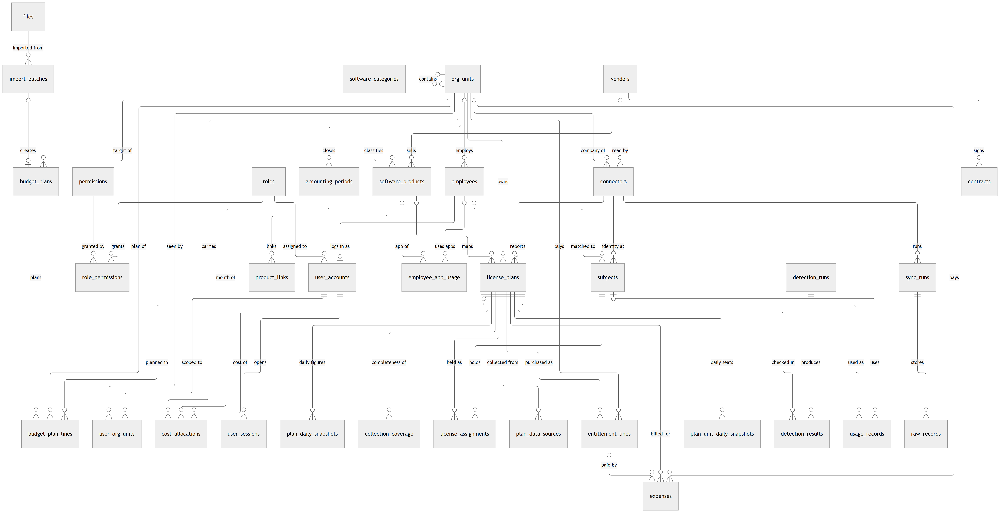
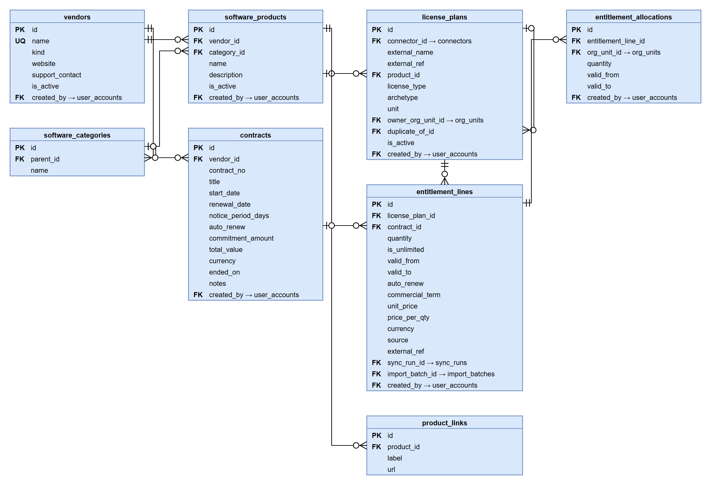
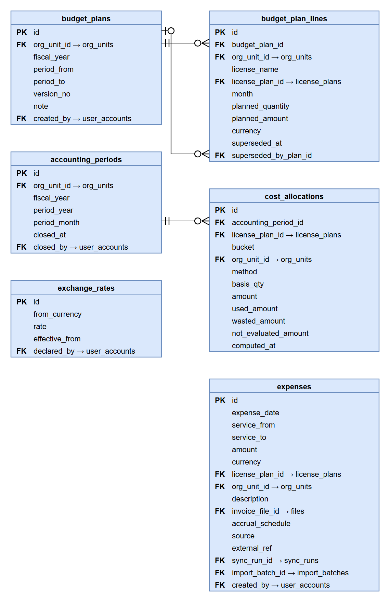
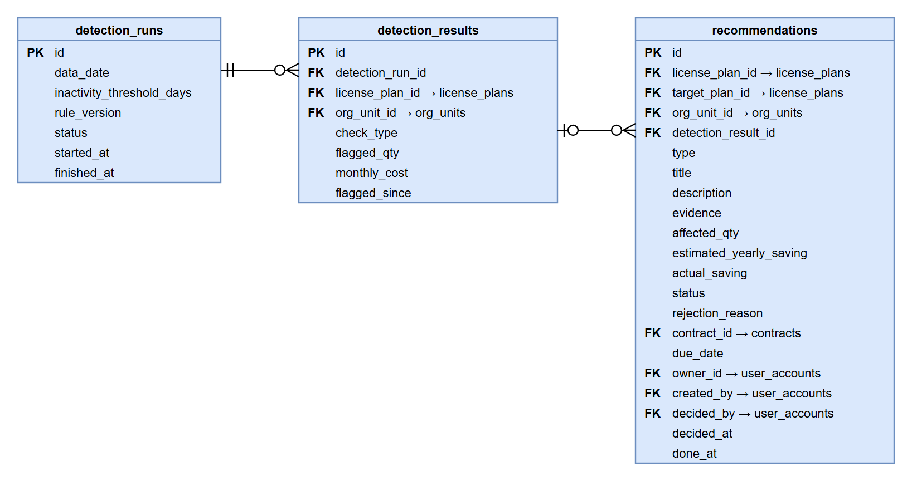
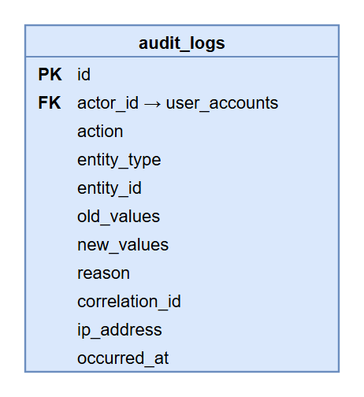

# Database Design

> Design status: TARGET (business model revision, 15 November 2026)
>
> Source: [`elms.dbml`](elms.dbml) (DBML, every rule in the table notes). Reference DDL: [`schema.sql`](schema.sql) (PostgreSQL 15+, generated from the DBML with `@dbml/cli` 12.0.0 plus partial indexes; not yet run against a database). Field by field, in plain words: [`tables.md`](tables.md). Diagrams: [`diagrams/`](diagrams/) — one draw.io ERD per group and the entity overview in Mermaid, each with PNG and SVG.

ELMS keeps, in one PostgreSQL database, what it reads from its sources — licenses, holders, and usage from one usage connector per company and provider, employees and units from ILVG, application usage from BCA — together with the budget plan imported from Excel, the expenses, the monthly cost split, and the waste checks. Nothing in it is written back to a source (BR-01). The schema has **40 tables in seven groups**; four of them belong to retired use cases and are kept but not written (D38).

## Conventions

| Topic | Decision |
|---|---|
| Naming | `snake_case`, plural table names |
| Keys | `bigint` identity on every table, so `audit_logs.entity_id` can point to any row |
| License | A license is one row of `license_plans`: one license a connector reports for one company, such as *Microsoft 365 E3* of company A (D1, D26). Its terms are `entitlement_lines`. Holders, usage, budget lines, and expenses point to it, so they survive renewals |
| Organization | Five fixed levels in `org_units`: group > P&L > block > department > project (BR-21, D24). Every figure of a unit is the sum of the units under it |
| Unknown | `NULL` means Unknown and is never read as 0 (BR-04). "Unlimited" is its own flag. A total with one Unknown part is Unknown |
| Money | `numeric(18,2)`. Amounts from outside (prices, expenses, budget lines) carry an ISO 4217 `currency`; figures ELMS computes are in the reporting currency (VND) and carry none. Amounts in different currencies are added only through `exchange_rates` (BR-05) |
| Quantities | `numeric(20,4)`: one column serves seats, sessions, tokens, and cores |
| State | No status column beside the field that decides it: the group is the unit without `parent_id`; a connector is paused while `paused_at` is set; a budget line is in force while `superseded_at` is NULL; a month is closed once `closed_at` is set; a detection result is not evaluated / clear / flagged when `flagged_qty` is NULL / 0 / more than 0. End dates are inclusive |
| Deletion | Master data is never deleted, only ended or marked inactive (BR-15); no cascading deletes |
| Provenance | Every collected row has `source` and the `sync_run_id` or `import_batch_id` that wrote it last, enforced by CHECK. Licenses, holders, and usage come from connectors only; `import` and `manual` remain for budget lines and expenses |
| Connector messages | Stored at the level they describe: a failed run in `sync_runs.error_message`; one license, kind, and day in `collection_coverage`; one record in `raw_records.normalize_error`. No secrets in messages |
| History | Providers give no history, so ELMS freezes results: daily snapshots, and monthly cost allocations when a month closes |
| Rules | Single-row rules are CHECK constraints; partial uniqueness is in `schema.sql`; cross-table rules are "App rule" lines in the DBML notes, enforced by the service in the same transaction |

## Entity overview



Source: [`diagrams/erd_overview.mmd`](diagrams/erd_overview.mmd) (Mermaid, ELK layout). Not drawn: the who-did-it columns (`created_by`, `paused_by` … → `user_accounts`), provenance (`sync_run_id`, `import_batch_id`), and the retired tables `entitlement_allocations` and `recommendations`.

## Organization and access


- **Five-level tree (D24, BR-21).** `org_units.level` is `group`, `pnl`, `block`, `department`, or `project`; the parent of a unit is one level up, and only the group has no parent. Units and their `code` come from ILVG; the budget file names units by this code. Admin corrects a unit ILVG placed wrongly through `data_overrides` (UC20).
- **People (D2).** `employees` is the ILVG directory; `org_unit_id` NULL is "Unknown unit". `unit_since` is the day of the last transfer, so usage and cost count toward the old unit before it and the new unit after it (BR-27). `project_ids` lists the projects of a person who works on several; a seat they hold counts toward each in equal parts (BR-06, D39). `user_accounts` has one row per employee and exactly one role (BR-17).
- **Scope (D25, BR-16).** `user_org_units` holds the units of a Manager — any level, the group included — and the companies of a Staff member — P&Ls, or the group for group-level Staff. Admin and Employee have no rows: Admin reads the group overview and the dashboards, down to each license; an Employee reads only their own licenses.
- **Logins (BR-18, D22).** One-time set-password link, 15-minute lockout after five failures, server-side sessions that end at once when an account is disabled.
- **Settings.** Not in the database: reporting currency (VND), inactivity threshold and new-seat grace (30 days each, BR-03), default sync interval (6 hours, BR-32), month-close day (10), raw data retention (180 days), set-password link validity (72 hours), budget preview validity (60 minutes).

## Software catalog and licenses



- **Licenses come from connectors (D26).** A `license_plans` row is declared by Staff when they create the connector (UC55) and stays *Pending* until the first sync; the sync fills its `external_ref`, `license_type`, terms, holders, and usage.
- **Catalog mapping (D28, BR-38).** `product_id` maps the license name to a software of the catalog (UC01), and the software has a category. Mapping one name maps the same name of the same provider in every company. NULL = *Not mapped*, grouped under *Uncategorized*.
- **Owner unit and shared licenses (D27, BR-26).** `owner_org_unit_id` is the P&L of the connector, or the group when the license is used by two or more companies. The owner carries the unassigned seats and plans the license; the held seats are charged back to the holders' units. When two connectors report the same license, Staff choose one and the other row gets `duplicate_of_id`, so it is counted once.
- **Terms (UC04, UC57).** `entitlement_lines` are the terms and purchases the connector reports: quantity, validity, `auto_renew`, and list price. Purchased quantity is the sum of the lines valid that day; the expiry drives the License List.

## Collection pipeline


- **Connectors (D26, D34, D37, D40).** A usage connector reads one provider for one company (`org_unit_id`, `vendor_id`; one active per pair), through the HTTPS API the P&L provides for its own data, with an API key or bearer token kept outside the database, a contact, and a `sync_interval_hours` that Staff type freely (default 6). Deleting a connector sets `is_active` false on it and its licenses; the data already collected stays. ILVG and BCA are connectors of their own `kind`.
- **License status (BR-32).** Computed: *Paused* while `paused_at` is set; *Pending* with no successful run since `reconfigured_at`; *Failed* when the latest run failed; *Delayed* when the last success is older than the interval; *Active* otherwise. Changing company, provider, authentication, or API URL moves `reconfigured_at`, so every license is Pending again.
- **Runs (A3, A4, BR-36).** One `sync_runs` row per run. While a connector is paused, every scheduled slot is still written, with status `paused`, so the pause shows in the run table of UC26. A failed or paused run writes nothing and the day stays Unknown. A rerun of the same day replaces its figures and never duplicates them.
- **Completeness (D8).** `collection_coverage` says, per license, kind, and day, whether the data is complete. A record that fails the license data contract is rejected with its reason (BR-19) in `raw_records.normalize_error`; a license the source reports but the connector does not declare is `undeclared_license`.
- **Imports (UC33, UC07).** `import_batches` of kind `budget` or `expense`, preview then confirm; one invalid row rejects the file. See *Budget versions* below for idempotency.

## Holders and usage


- **Identities (D35, D41).** `subjects` belong to the connector (company tenant) that reports them, with an `account_type` of `personal`, `shared`, or `service`. A shared or service account is judged as a whole: used by anyone in the last 30 days = Active (BR-28). A personal identity is matched to the ILVG employee; one employee can have several identities.
- **Seat status (BR-03, D31)** is computed on the data date for an open assignment:

  | Status | Rule |
  |---|---|
  | `Not monitored` | No usage source for the license, or the source gives totals only |
  | `Active` | Used in the last 30 days, or given less than 30 days ago and not used yet (grace period) |
  | `Inactive` | Used before, but not in the last 30 days |
  | `No activity` | Never used, and held for 30 days or more |

- **Usage frequency (BR-35).** Days used = the `active_days` usage records of the holder over the period, shown against working days (Monday to Friday without public holidays) as a bar, for example 6 / 22, without bands; *Not tracked* when the source gives only the last activity date (`plan_data_sources.has_daily_activity`).
- **Snapshots.** `plan_daily_snapshots` keeps Purchased quantity and the list monthly cost per license and day; `plan_unit_daily_snapshots` keeps the seats per status and unit per day as shares (a person on two projects counts half in each), with the shared/service part counted apart. Both are frozen.
- **BCA (D36, BR-23).** `employee_app_usage` keeps which application each employee used, on how many days and for how many minutes, in its own table. Assumed until the BCA API is known: per day, the domain account carrying the ILVG employee code. Only the Managers of the employee's units read it (UC32).

## Budget, cost, and expenses



- **Budget versions (D29, BR-08).** Each confirmed import creates a `budget_plans` version for its target unit and months. Its `budget_plan_lines` belong to the deepest unit they name, per license and month; the lines of the target and every unit under it for those months are marked `superseded_at`, never deleted. A unit's Plan = its own lines + the Plan of the units under it, so no line is counted twice. The Manager of a P&L can replace the plan of the P&L and each block; the Manager of a block only that block. A shared license is planned by the group per P&L that uses it, or deeper, so each P&L's Plan includes its share; P&L Managers can then change or add the lines of their units.
- **Idempotent import (D30, BR-36).** The same file (`files.checksum`) for the same target and months gives `unchanged` and no version. `preview_key` makes the confirm happen once whatever the clicks or retries. `based_on_budget_plan_id` refuses a confirm when another Manager imported since the preview.
- **Plan judged where it is set (BR-37).** Cost of a license that has no line at a unit but has one at a unit above — for example a license a P&L plans for all its blocks with one P&L line — shows as *Planned at <unit>* below and is left out of the lower units' variance.
- **Purchased = accrued cost of the invoices (D33).** An expense names the term it pays for (`service_from`, `service_to`); its `accrual_schedule` spreads the amount over the months, rounded to the thousand VND, with the difference in the last month (BR-25). An amount in another currency is converted with the rate of its invoice date (BR-05). Months are closed per company in `accounting_periods` (UC42); an open month is *Provisional* (BR-31).
- **Used, Wasted, Not evaluated (D32, BR-24).** `cost_allocations` splits the accrued cost of each license and month by the seats on the last day of the month: the units of the holders, `unallocated` (seats nobody holds, under the owner), and `unknown_unit` (holders that cannot be placed). Each row carries `used_amount`, `wasted_amount`, and `not_evaluated_amount`, which add up to `amount`. A unit is red when Wasted is above 20 % of Purchased (BR-22). The unit rows of a shared license are its charge-back to the companies.
- **Exchange rates (D12).** Every rate converts to VND; the rate of a day is the latest `effective_from` on or before it.

## Optimization



- **Results (BR-12).** One `detection_results` row per run, license, check, and unit. Checks: `unused` (seats nobody holds, owner unit), `inactive` (Inactive and No activity), `overuse` (allocated above purchased, BR-34), `leaver` (D20). The verdict is read from `flagged_qty`: NULL = not evaluated, 0 = clear, more than 0 = flagged.
- **Shared and service accounts (BR-28)** are judged as whole accounts and listed apart in UC11, never as inactive people.
- **Retired.** `recommendations` (UC13, UC14) is kept and not written (D38).

## Audit



- **Audit log (BR-15).** Append-only: connectors (create, edit, pause, resume), budget imports, catalog mappings, shared-license marks, expenses, users, units, roles, and permissions.
- **Overrides (UC20).** Admin corrections of ILVG data, such as a unit under the wrong parent, keep the original value beside them; licenses, holders, and usage are corrected at the source (BR-01).

## Tables

A plain-language tour of the 40 tables. Every field is explained in [Tables and fields](tables.md); exact rules are in [`elms.dbml`](elms.dbml).

### Organization and access

- **`org_units`**: the group, its P&Ls, blocks, departments, and projects, as ILVG gives them, each with its code.
- **`employees`**: everyone who works in the group, with their current unit, the day they joined it, and their projects when they have several.
- **`user_accounts`**: the people who can log in, each with one role.
- **`user_sessions`**: who is logged in right now.
- **`roles`**: Admin, Manager, Staff, and Employee.
- **`permissions`**: everything that can be allowed, such as "connectors – write".
- **`role_permissions`**: the tick boxes of the permission matrix.
- **`user_org_units`**: the units a Manager looks after and the companies a Staff member works on.

### Software catalog and licenses

- **`vendors`**: the providers, such as Microsoft or Atlassian.
- **`software_categories`**: categories and subcategories of the catalog.
- **`software_products`**: the software of the catalog, such as "Microsoft 365", that license names map to.
- **`license_plans`**: each license a connector reports for a company, with its owner unit and its software.
- **`entitlement_lines`**: the terms of each license: quantity, start, expiry, auto-renew, list price.
- **`product_links`**, **`contracts`**, **`entitlement_allocations`**: retired, kept and not written.

### Collection pipeline

- **`connectors`**: the usage connectors of each company and provider, and the ILVG and BCA sources, with their interval, pause, and deletion.
- **`plan_data_sources`**: which data the connector of each license delivers, and how.
- **`sync_runs`**: the log of each run, paused runs included.
- **`collection_coverage`**: for each license, kind of data, and day, whether ELMS got everything.
- **`raw_records`**: what the source sent, kept 180 days, with the reason when a record was rejected.
- **`files`**: invoices, budget files, and expense files.
- **`import_batches`**: each budget or expense import, with its target, months, and idempotency key.

### Holders and usage

- **`subjects`**: the identities at each company's provider tenant, with their account type.
- **`license_assignments`**: who holds which license, and when they last used it.
- **`usage_records`**: active days per holder, sessions, consumption, deployed units.
- **`plan_daily_snapshots`**: daily Purchased quantity and list cost of each license.
- **`plan_unit_daily_snapshots`**: daily seats per status and unit, as shares.
- **`employee_app_usage`**: which applications each employee uses, from BCA.

### Budget, cost, and expenses

- **`budget_plans`**: one version per confirmed budget import.
- **`budget_plan_lines`**: the plan per unit, license, and month, with the versions it replaced.
- **`cost_allocations`**: Purchased, Used, Wasted, and Not evaluated of each license and month, per unit.
- **`expenses`**: invoices, the term they pay for, and their monthly accrual.
- **`accounting_periods`**: the months of each company and whether they are closed.
- **`exchange_rates`**: the rates used to convert currencies to VND.

### Optimization

- **`detection_runs`**: each daily check, with the threshold it used.
- **`detection_results`**: unused, inactive, overused, and leaver seats per license and unit.
- **`recommendations`**: retired, kept and not written.

### Audit

- **`audit_logs`**: who changed what, when, and why.
- **`data_overrides`**: Admin corrections of ILVG data.

## Rule-to-schema traceability

| Rule | Where it is enforced in the database |
|---|---|
| BR-01 Read-only toward sources | No write-back table; licenses, holders, usage only from `sync_runs` (provenance CHECKs, `chk_plan_data_sources_connector_only`) |
| BR-03 Seat status | `license_assignments.last_active_at`, `assigned_on`; `plan_data_sources.granularity`, `monitoring_since`; counts in `plan_unit_daily_snapshots` |
| BR-04 Unknown is not 0 | Nullable figures; `collection_coverage`; snapshot counts without defaults; `cost_allocations.not_evaluated_amount`; `detection_results.flagged_qty` NULL |
| BR-06 Cost allocation | `cost_allocations` (bucket, owner unit for `unallocated` and `unknown_unit`); `employees.project_ids`; seat shares in `plan_unit_daily_snapshots` |
| BR-08 Budget | `budget_plans` versions, `budget_plan_lines.org_unit_id`, `superseded_at`, `uq_budget_plan_lines_current` |
| BR-15 Audit | `audit_logs` (single-column `id` on every table) |
| BR-16 Data scope | `user_org_units`, `license_plans.owner_org_unit_id`, unit on results |
| BR-17 Roles | `user_accounts.role_id` NOT NULL; `role_permissions` |
| BR-18 Login | `failed_login_count`, `locked_until`, `user_sessions.token_hash` |
| BR-20 Credentials | `connectors.credentials_ref` (secret kept outside), `chk_connectors_https` |
| BR-21 Hierarchy | `org_units.level`, `chk_org_units_group_root`, `uq_org_units_group_root` |
| BR-23 Employee usage | `employee_app_usage` |
| BR-24 Waste | `cost_allocations.used_amount`, `wasted_amount`, `not_evaluated_amount`, `chk_cost_allocations_split` |
| BR-25 Accrual | `expenses.service_from`, `service_to`, `accrual_schedule`; `accounting_periods.closed_at` |
| BR-26 Shared license | `license_plans.owner_org_unit_id` = group; `duplicate_of_id` |
| BR-28 Account type | `subjects.account_type`; `plan_unit_daily_snapshots.shared_service_qty` |
| BR-32 Connector status | `connectors.sync_interval_hours`, `reconfigured_at`, `paused_at`; `run_status` `paused` |
| BR-22 Waste flag | Computed from `cost_allocations`: Wasted above 20 % of Purchased |
| BR-35 Frequency | `usage_metric` `active_days`; `plan_data_sources.has_daily_activity` |
| BR-36 Idempotency | `files.checksum`, `import_batches.preview_key`, `based_on_budget_plan_id`, `import_status` `unchanged`; `uq_entitlement_lines_plan_external`, `uq_expenses_plan_external`, `uq_usage_records_period` |
| BR-38 Catalog | `license_plans.product_id`, `software_products.category_id` |

## Decisions

D1–D23 came from the first design (November 2026). The business model revision keeps D1, D2, D5, D7–D10, D12–D14, D20, and D22, supersedes the others, and adds D24–D41. All D24–D41 need team confirmation.

| # | Question | Decision |
|---|---|---|
| D24 | How deep is the organization? | Five fixed levels in `org_units.level`; the group is the only root; units and codes from ILVG |
| D25 | Where is the scope of a Manager and of a Staff member? | `user_org_units` (was `manager_org_units`): Manager units at any level, group included; Staff companies or the group |
| D26 | What is a license now? | A row per license a connector reports for one company; one usage connector per company and provider |
| D27 | Who owns a shared license? | The group; held seats charged back to the holders' companies; a license reported twice is counted once (`duplicate_of_id`) |
| D28 | How do license names get a category? | `license_plans.product_id` → `software_products.category_id`; NULL = Not mapped |
| D29 | How are budget changes kept? | A version per confirmed import; lines superseded, never deleted; a line belongs to its deepest unit |
| D30 | How is a budget import made idempotent? | File checksum, preview key, version seen at preview, `unchanged` status |
| D31 | Seat status and frequency | 30 days, 30-day grace for new seats; days used from `active_days`, no bands |
| D32 | How is waste stored? | Used, Wasted, Not evaluated on each `cost_allocations` row; `unallocated` and `unknown_unit` under the owner |
| D33 | Where does Purchased come from? | Accrued cost of the invoices, rounded to the thousand VND, converted at the invoice-date rate |
| D34 | Sync interval and pause | Interval per connector; `paused_at`; a paused slot is a `sync_runs` row with status `paused` |
| D35 | Identities when each company has its own tenant | `subjects` belong to a connector; `account_type` personal / shared / service |
| D36 | Where is BCA data kept? | Its own table, `employee_app_usage` (the 40th table) |
| D37 | How are ILVG and BCA monitored? | As connectors of their own `kind` |
| D38 | What happens to tables of retired use cases? | `contracts`, `entitlement_allocations`, `product_links`, `recommendations` kept, not written |
| D39 | A person on several projects | `employees.project_ids`; a seat counts toward each project in equal parts; seat counts are shares |
| D40 | Deleting a connector | `is_active` false on the connector and its licenses; data kept; one active connector per company and provider |
| D41 | Shared mailboxes and service accounts | Judged as whole accounts: Active or Inactive like any seat, cost Used or Wasted |

Superseded: D3 and D19 (quotas), D4 (one yearly budget per unit), D6 (service month), D11 (one tenant per vendor), D15 and D16 (recommendations, contract notice periods), D17 (prices typed by Staff), D18 (manual holders and usage), D21 (HR CSV import), D23 (reseller contracts). Their history is in the git log of this file.

## Seed data

| Table | Rows |
|---|---|
| `roles` | `ADMIN`, `MANAGER`, `STAFF`, `EMPLOYEE` |
| `permissions`, `role_permissions` | The role × feature matrix of [Use cases](../02-use-cases.md) |
| `org_units` | The group row (level `group`); the rest comes from ILVG |
| `employees`, `user_accounts` | One `ADMIN` account from deployment secrets |
| `connectors` | The ILVG and BCA connectors; usage connectors are created by Staff (UC55), simulated ones (`is_simulated = true`) for demos |

## Regenerating

```bash
npx -p @dbml/cli dbml2sql docs/database/elms.dbml --postgres   # generated part of schema.sql
cd docs/diagrams && python ve_erd.py                           # diagrams/*.drawio, .png, .svg
```

The generated part of `schema.sql` is followed by the indexes DBML cannot express (partial, case-insensitive, NULLS NOT DISTINCT), listed in the table notes. `ve_erd.py` draws the group ERDs from `elms.dbml` with the team library `srsdiagram.py` (Pillow, Playwright Chromium), renders `erd_overview.mmd` with Mermaid (downloaded from jsDelivr, so it needs network), and deletes the old `.drawio`, `.png`, and `.svg` files first. It stops if a table is missing from `LAYOUT` or the overview names a table that no longer exists.

**Related:** [Use cases](../02-use-cases.md) · [Feature list](../08-feature-list.md) · [Top-down research](../01-research-top-down.md)
