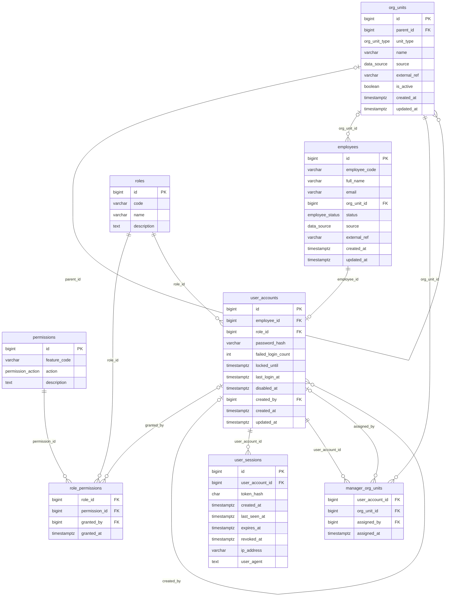
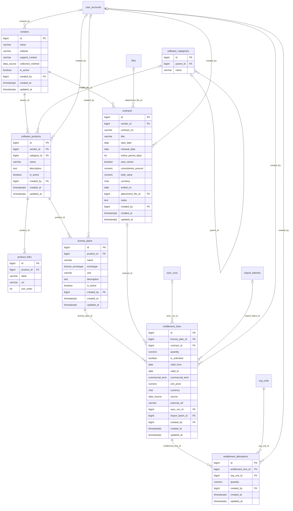
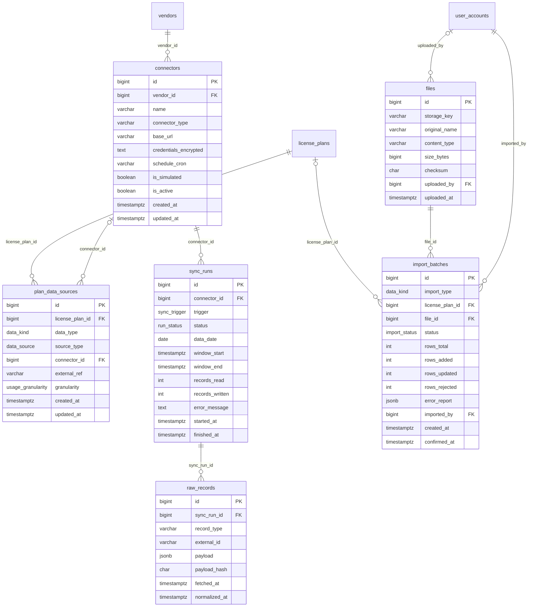
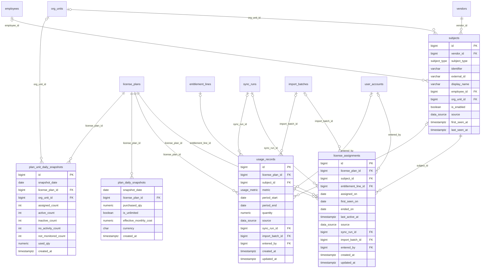
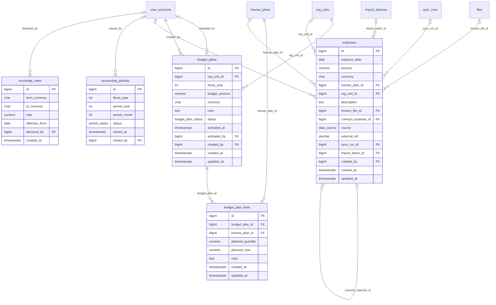
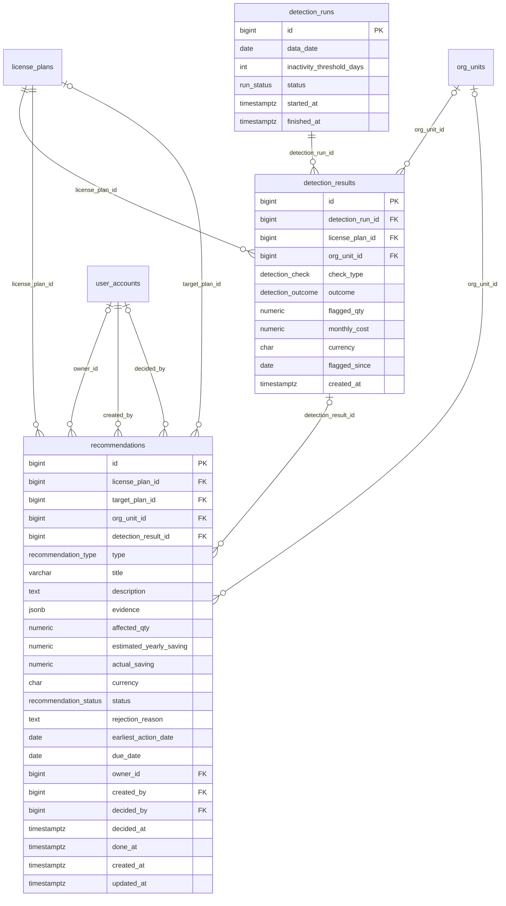
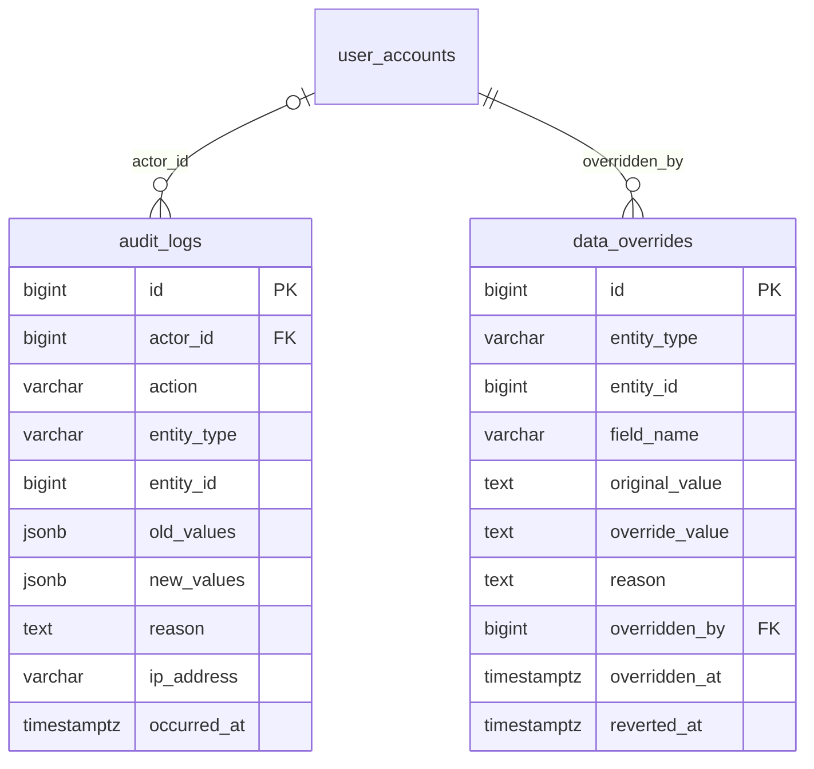

# ELMS entity-relationship diagrams (Mermaid)

> Generated from [`elms.dbml`](elms.dbml), which is the source of truth. Do not edit by hand: change the DBML, then regenerate. Design status: **target** (nothing implemented yet).

37 tables in 7 groups. Relationship legend: `||--o{` one-to-many, `||--o|` one-to-one, `|o--` optional parent (nullable foreign key). Enum columns show the enum name as their type; enum values are listed in the DBML. Tables from another group appear as bare boxes so cross-group foreign keys stay visible.

## Contents

- [Organization and access](#organization-and-access) — `org_units`, `employees`, `roles`, `permissions`, `role_permissions`, `user_accounts`, `user_sessions`, `manager_org_units`
- [License catalog](#license-catalog) — `vendors`, `software_categories`, `software_products`, `product_links`, `license_plans`, `contracts`, `entitlement_lines`, `entitlement_allocations`
- [Collection pipeline](#collection-pipeline) — `connectors`, `plan_data_sources`, `sync_runs`, `raw_records`, `files`, `import_batches`
- [Holders and usage](#holders-and-usage) — `subjects`, `license_assignments`, `usage_records`, `plan_daily_snapshots`, `plan_unit_daily_snapshots`
- [Budget and expenses](#budget-and-expenses) — `budget_plans`, `budget_plan_lines`, `expenses`, `accounting_periods`, `exchange_rates`
- [Optimization](#optimization) — `detection_runs`, `detection_results`, `recommendations`
- [Audit](#audit) — `audit_logs`, `data_overrides`

## Organization and access

## License catalog

## Collection pipeline

## Holders and usage

## Budget and expenses

## Optimization

## Audit

